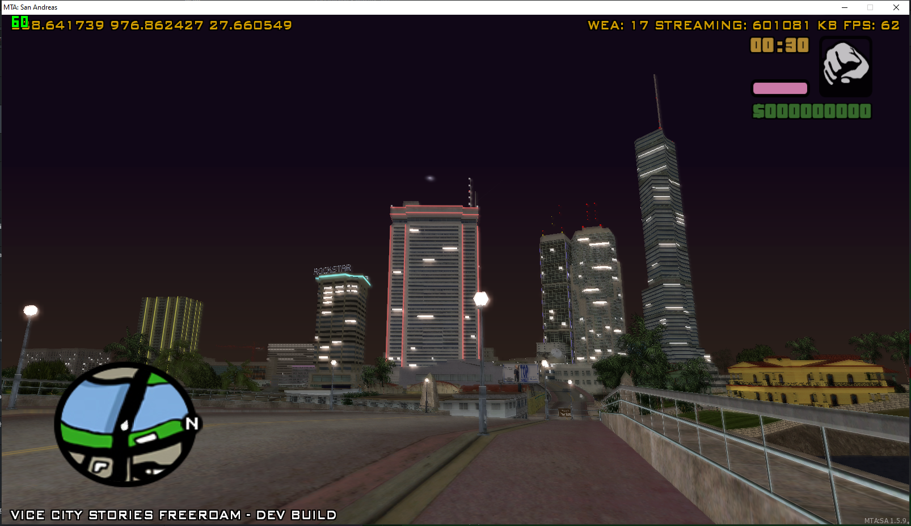

# Multi Theft Auto: Vice City Stories Map 



A Total Convention of VCS Map to MTASA with original game atmosphere.
The goal of this project is to provide a boilerplate for your further gamemode development.
This resource includes VCS styled map, hud, vehicles, weapons, peds, weather, etc.
Currently, many things are still working in progress, if you find any issue or you want to contribute, you're welcome!

## Reload VCS scripts

The server starts `eagleLoader`, `vcs`, and then `leeds_engine`. After changing a VCS script, run `restart leeds_engine` in the server console. The engine stops the managed scripts in reverse dependency order, then starts them with the changes on disk. The map and Eagle Loader stay running.

During an engine reload, the client keeps the San Andreas HUD and native color filter suppressed and carries the VCS weather through the restart.

After adding a resource directory, run `refresh` before `restart leeds_engine`. When deploying a resource rename such as `ui` to `frontend`, stop the MTA server, replace the resource files, then start the server again.

For a server already running before this change, run `reloadacl`, `refresh`, and `start leeds_engine` once. Update the ordered list in [resources.lua](mods/deathmatch/resources/%5Bvcs%5D/leeds_engine/resources.lua) when adding a VCS script resource. Optional entries are reloaded when they are running.

## Gameplay HUD

Run the importer before starting the server. Point it at the unpacked US PS2 release (SLUS-21590 v1.00).

```powershell
py tools/import_vcs_frontend.py 'D:\ps2_game\Grand Theft Auto - Vice City Stories (USA)'
```

It extracts the HUD and font atlases from `PS2/GAME.DTZ`, the weapon icons and radar map from `GTA3PS2.IMG`, the text from `AMERICAN.GXT`, and the HUD samples from the `AUDIO/SET0` sound bank. The generated `frontend/ps2` directory is local to each deployment. Its manifest records the sources, offsets and SHA-256 hashes.

With Pillow and Lupa installed, run `py tools/check_vcs_hud_aspect.py --output hud-aspect.png` to render the imported HUD across six resolutions and verify the radar diameter and placement.
Run `py tools/check_vcs_font_layout.py --output hud-font-layout.png` to verify the original font atlases and gameplay text scaling.

Gameplay scripts call `exports.frontend`. Numeric GameText styles `0–7` use independent styled text slots. Style `8` is the project’s compatibility entry for location names. Use `showGameText(text, style, duration)` for `VEHICLE_NAME`, `LOCATION_NAME`, `garage`, `radio`, and `radioTuning`. Durations are in milliseconds. A duration of `0` keeps a named style or caption visible until replaced or hidden.

Client scripts can show a pager with `showVcsPager(text, duration)` or start a countdown with `showVcsCountdown(label, duration, warningSeconds)`. They can clear those displays using `hideVcsPager()` and `hideVcsCountdown()`.

Use `showTextBox(text, duration, playCue)` for top-left prompts. It plays the original help cue on each successful call unless `playCue` is `false`. Use a duration of `0` to keep the message visible and `showTextBox(false)` to clear your resource's message. Server callers pass the target player first.

Register mission NPCs with `showNpcHealthBar(ped, label, slot, maxHealth)` and remove them with `hideNpcHealthBar(slot)`. From a server script, pass the recipient player first to either function. There are three slots. A missing slot uses `1`, and a missing maximum health uses `100`. The bar follows the ped's synchronized health and reappears when a living target streams back in.

With the `debug` resource running, use `/hudtext <style> [text]` to preview any of the styles above and `/hudcaption [text]` to show or clear a persistent caption. Users with permission for `command.hudnpc` can use `/hudnpc show 1`, `/hudnpc health 1 25`, `/hudnpc dimension 1 1`, and `/hudnpc destroy 1` to test a targeted bar.

# Bug and Issue
* Wrong LODs position and rotation for some objects (LODs with duplicated objects not working)
* Timed Object are missing

# Progress
* Map
  * Interiors
  * Empire Buildings
  * Objects Fix
    * ~~Aplha Blending Textures~~
    * ~~Breakble Objects~~
    * ~~Time Object~~
    * UV Animation
    * Incorrect Objects Roatation
    * ~~Txds Mapping (Needs custom implmention fix txdp flag)~~
   * 2DFX Lighting Fix - Done
     * ~~Street Lamp (Done)~~
     * ~~Traffic Light (Done)~~ 
* Vehicle (Partially done)
* Peds
* Weapons
* HUD/UI
  * Game Texts
    * ~~Radio~~
    * ~~Vehicle Name~~
    * Zone Name
  * HUD
    * Weapon
    * ~~Health~~
    * ~~Armour~~
    * ~~Oxygen (In Water)~~
    * ~~Cash~~
* Radio Stations - Done
    * ~~Flash FM~~
    * ~~Emotion~~
    * ~~Wave 103~~
    * ~~Praradise~~
    * ~~Fresh FM~~
    * ~~VCFL~~
* Post Fx
    * Shader 
      * ~~Sun Effect~~
      * ~~Trail~~
      * ~~Radiosity~~
      * ~~Building Pipeline~~
      * Water Pipeline
      * Leeds Vehicle Pipeline
      * Grading
    * Weather
      * ~~Timecyc~~ (Note Some parameter is not supported by mta yet, but all supported have been correctly ported) 
      * ~~Color filter~~
    * Particle FX
      * ~~Water (Only the texture is ported)~~
      * ~~Clouds~~
      * Explosion FX
      * Fire
      * ~~Corona (Light Particle)~~
