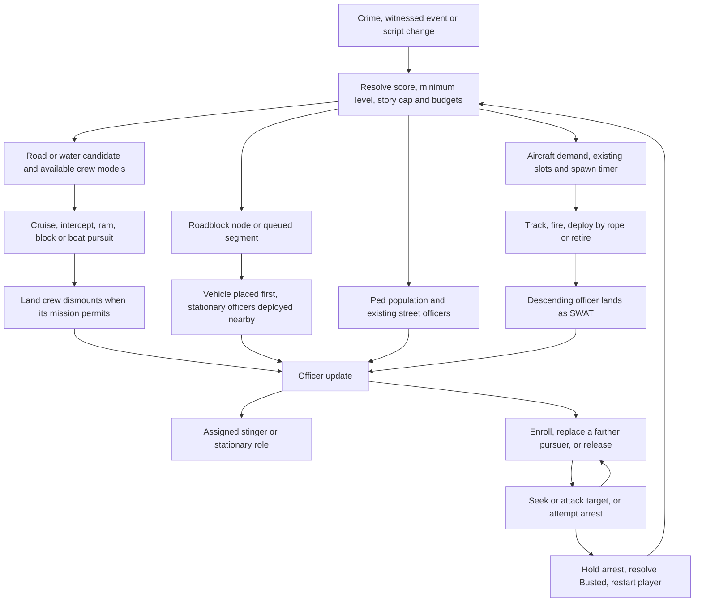

# Vice City Stories police AI · US PlayStation 2

The wanted update sets the response budget. Population and vehicle managers decide which units can appear. Each officer then competes for a pursuit slot and makes decisions using the player's state, current objective, weapon, range and vehicle. A spawned unit, an on-duty vehicle and an enrolled officer are three different things in the executable.

The [MTA acceptance report](../qa/vcs-police-ai/README.md) records which units appeared on the live client at each level, the custody outcome, screenshots and measured frame times. The [resource API](resource-api.md) explains how server scripts set wanted levels and how the frontend receives changes.

## What changes with each star?

These are ordinary free-roam rules with the initial score ceiling and clear override flags. “Officers” is the pursuit roster allowance. “Vehicles” is the on-duty traffic budget, shared with police boats. Counts describe eligibility. Actual street population, loaded models and cooldowns determine what the player sees. [Score and dispatch branches](wanted-and-dispatch.md)

| Stars | Minimum points | Officers / vehicles | Change at this level |
|---:|---:|---:|---|
| 1 | 40 | 2 / 1 | Existing patrols can engage. The traffic generator has no forced police pick. An enrolled, initially unarmed officer can select the baton. A qualifying absence of nearby police permits score decay. |
| 2 | 180 | 3 / 2 | Passive decay stops. Eligible traffic attempts a forced police pick when the low 16 random bits modulo 31 exceed 15. A patrol car requests a front passenger. An enrolled officer with active weapon ID zero selects the pistol. The police boat selects its dedicated chase mission. |
| 3 | 550 | 4 / 3 | Eligible traffic passes the forced pick without the two-star roll. Undercover pairs, targeted foot population, roadblocks and one Police Maverick become eligible. Helicopter firing acquisition against the player ped takes 10 seconds under ordinary flags. |
| 4 | 1200 | 6 / 3 | SWAT models are requested. A moving specialist selection can still produce a patrol car. A helicopter close enough to deploy can drop SWAT officers if their model is resident. Helicopter firing acquisition is 5 seconds. |
| 5 | 2400 | 8 / 4 | The ordinary specialist request switches to FBI. A loaded FBI car can carry a four-officer crew. Undercover selection still has priority when ready. Helicopter firing acquisition is 3.5 seconds. |
| 6 | 4800 | 10 / 4 | Army selection can produce a Barracks or Rhino. An army roadblock requests a Barracks. Air demand remains one and player-ped firing acquisition falls to 2 seconds. |

The four positive roadblock thresholds, 12/18/24/30, all accept the same two outcomes because the game masks the random value with `0x64`. The four helicopter times describe an acquisition gate, before the separate shot cooldown. An eligible occupied-car target uses a 5-second gate at every level. [Ground response](ground-response.md) · [Aircraft and watercraft](vehicle-and-special-response.md)

## From incident to release

The arrows show dependencies between independently updated systems. Within an officer update, early returns and subtype overrides matter. For instance, a successful car-entry arrest can place the officer in the arresting state before the vehicle callback moves the player into the arrested state. [Ordered officer decisions](officer-behavior.md)

## Reading the reconstruction

- [Wanted score, crime reporting and dispatch](wanted-and-dispatch.md) covers first-star acquisition, score changes, respray, direct changes and unit eligibility.
- [Police cars, bikes and roadblocks](ground-response.md) follows model selection, seat requests, road missions, dismounts and barrier placement.
- [Police officers, pursuit and arrest](officer-behavior.md) follows enrollment, equipment, combat, custody, spike strips and release.
- [Police aircraft and watercraft](vehicle-and-special-response.md) follows the helicopter and boat from selection through pursuit and retirement or break-off.
- [Evidence, verification and coverage limits](evidence.md) identifies the source build, address crosswalk, executable checks and remaining uncertainties.
