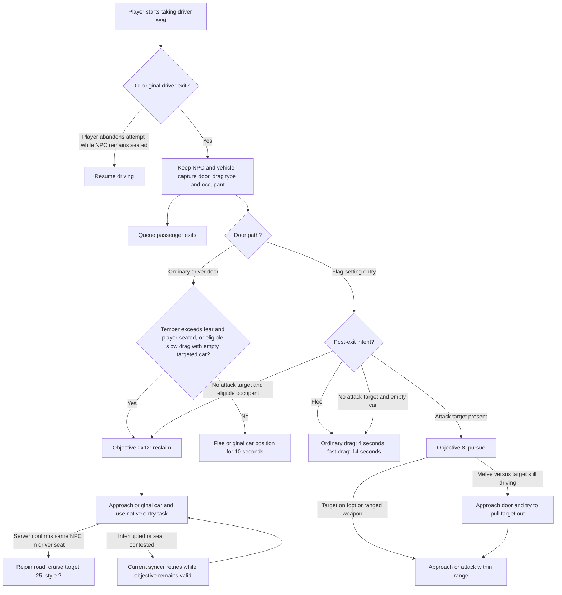

# Recovering a stolen traffic car

The US PS2 executable `SLUS_215.90` stores the driver at vehicle+0x384. On a ped, +0x8A4 is the current objective, +0x8A0 the target ped, +0x484 the target vehicle and +0x480 the occupied vehicle.

## From entry to landing

| Event | Original-game branch |
|---|---|
| Starting entry | `0x002FD838` checks vehicle, door, entry state and seat. On the eligible entry path, `0x002FDCB0` compares signed fear (+0x16) against temper (+0x17). If temper exceeds fear and neither driver nor car has creation source 2, set bit 62, clear bit 47 at ped+0x1C8 and request objective 8 against the jacker. Failing these tests sets bit 47. Another drag-out path compares personality after landing. |
| Taking a police car | On that retaliation branch, driver type 6 and a player jacker call `0x002379E0(player,1)` at `0x002FDD54`, requesting at least one wanted star. |
| Removing the driver | `0x00300818` switches the same ped to state 0x3C and requests speech 0x7A for a regular car. `0x001FEA30` clears its seat and registers completion. Animation 0x40, CAR_Qjacked, selects fast drag `0x00306010`; ordinary drag uses `0x00306680`. |
| Flee flag | Fast drag at `0x003062AC–0x003062FC` consumes the flag and flees the vehicle coordinates for 14000 ms. Ordinary drag at `0x00306C28` uses 4000 ms. Both have a separate unflagged 10000 ms fallback. |
| Retaliation flag | Consume the flag. With an existing attack target, fast drag at `0x0030646C` retains or restores objective 8 against it; ordinary drag at `0x00306BAC` uses the car's **current driver**. With no attack target, another eligible driver in the seat permits clearing the old objective and requesting 0x12 against the car. A player driver faces an additional script check. Fast drag can request speech 0x8E at `0x00306520`. |
| Neither flag | Fast drag at `0x00306530–0x00306594` checks temper/fear, creation sources, whether the player is driving and script predicate `0x00255DA8`. Success requests 0x12, failure flees for 10 seconds. Ordinary drag at `0x00306C94` also accepts an empty car referenced by player+0x484. |
| Passengers | `0x003EF018` iterates passengers separately. Ordinary exit deadlines start at 1800 ms, increasing by 300–599 ms per eligible passenger. Some car passengers receive 10000 ms. |

## Door pursuit and recovery

Objective dispatcher `0x003BC9A8`, case 8 at `0x003BFAEC`, first checks whether the **actor** is still in a vehicle. On foot, the melee executor is `0x00101D30`, the non-melee executor `0x00100BA0`. Their door-selection paths can use driver door 10 or passenger doors 8, 11 and 9. `0x00101CA8` calls `0x00303800` for the door position and `0x0020B460` to approach it. The target leaving or dying, actor occupancy, vehicle type, weapon and police status affect subsequent decisions. A moving car can escape; an opponent on foot can still be pursued. [Combat execution](vcs-npc-combat.md)

Objective 0x12 follows the vehicle, checking its reference, seat, control and deadline before approaching the door. Passenger objective 0x11 has a different completion. At `0x001FF648–0x001FF6AC`, a randomly created non-player driver (ped+0x8F4 == 1) with objective 0x12 and type other than 0x10 rejoins the road network at `0x001FF680`. The game sets cruise mission 1, cruise target 25 in autopilot units, driving style 2, temporary action 0 and ped state 0x37. Physics determines actual speed.

An original-game trial saw model 35 flee at health 100 as the player took the wheel. This exercises one path. For SA architecture see `gta-reversed/source/game_sa/Events/EventDraggedOutCar.cpp` and `Tasks/TaskTypes/TaskComplexCarSlowBeDraggedOutAndStandUp.cpp`.

## Fast and ordinary drag at the driver door

`0x003EFD28` selects the animation. Front left is vehicle component 2 and ped door 10. With driver in state 0x37, a jacker entering under 0x12 and a suitable regular car, the jacker can play CAR_Qjack (0x3F) and immediately fast-drag the driver. Buses and low cars take other paths; rear-left component 4 excludes van rear doors. The lock must permit entry. Detached doors (damage 3) and doors already open within 0.5 radians of their limit can bypass selection via virtual slots 0x9C and 0x94 respectively. The car constructor copies handling+0xD0 flags for van (1), bus (2) and low car (4). Fast drag calls at `0x003EFEDC`, ordinary drag at `0x002FD610`. This selector uses no random draw or fixed speed threshold. Reachability and vehicle motion are checked upstream.

`0x002FD838` skips flag preset for door 10. Landing can therefore recompute personality directly for either driver-door drag. Fast drag requires the player already in the seat for the unflagged reclaim path; ordinary drag can use the player's target-car reference while the seat is empty.

## Original controller traces

In PCSX2 the player jacked model 26 from the left. Fear was 30 and temper 70. Both preset flags remained zero. At 2.165 s the NPC had left and started fleeing with the seat still empty. At 2.422 s the player became the driver. Entering from the right against the same personality set retaliation at 1.44 s and objective 8 at 1.594 s. The NPC reached the driver door near 3.29 s, pulled the player out at 3.95 s and was on foot with the player by 5.08 s. Its later attacks reduced player health from 100 to 55.4.

## Traffic resource behavior

Trace capture, intent and handover through `ped_carjack.lua` (`capture`, `decide`, `seated` in the documented resource version). The native task approaches the door, pulls the occupant and enters. The server returns the car to traffic AI once the same NPC owns the seat. A melee pursuer who briefly enters can leave to continue fighting. A driver who regains the car can steer around traffic when space permits. MTA approximates the door threshold with half-open normalized travel. Mission-owned NPCs follow their owning resource. [MTA vehicle entry](https://wiki.multitheftauto.com/wiki/SetPedEnterVehicle)

A separate PCSX2 trial put the player on foot and assigned model 35 objective 18 (decimal) against the original vehicle. The same NPC entered with state 55, style 2, mission 1, temporary action 0 and cruise target 25. This checks the assigned objective's execution and completion; the controller traces above cover natural selection.
