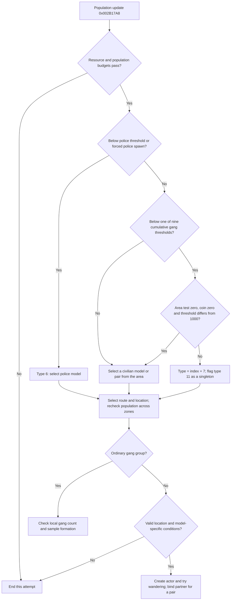
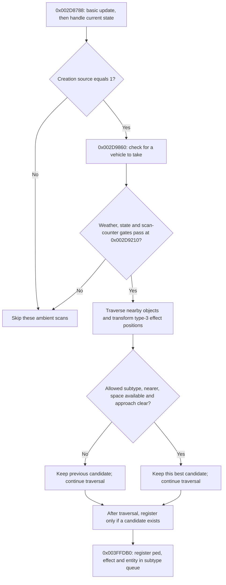
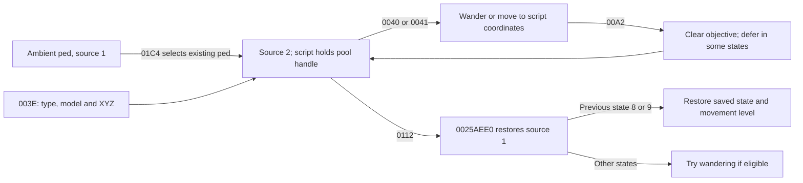

# Freeroam population, wandering, activities and script control

Addresses refer to US PS2 VCS, `SLUS_215.90`. Read type at ped+0x550, personality pointer at +0x554, objective at +0x8A4, state at +0x8C4, movement level at +0x8D4 and creation source at +0x8F4. Track these independently. For instance, a script can take control of a civilian who is already fleeing.

## Population selection and first action

| Step | PS2 decision and result |
| --- | --- |
| Resources and quota | 0x002B17A8 returns if 0x002BC1A8 yields less than 0x19000. It reads the local zone record and counts, adjusts the limit using player and weather state, and stops at the limit unless forcing police. |
| Ped type | Compare one 0–999 sample strictly against the police threshold and then the nine gang thresholds. Equality advances to the next check. The first matching gang threshold triggers a separate coin draw. The area's predicate in the diagram is 0x002AFC20(playerPos,2). For civilians, another float sample at or below 0.95 calls 0x002B35B0. Above 0.95, 0x002B37C8 selects a pair. Missing required models terminate the attempt. A positive DAT_00487FFC can override type outside forced police spawning. |
| Group size and placement | For types 7–15 outside the singleton case, 0x002B45C8 requests two or three actors. 0x002B3B90 identifies type 11 as the singleton exception. Failed placement terminates the attempt. Crossing a zone boundary rechecks destination gang thresholds using the original 0–999 sample. See 0x002B1D40–0x002B1FEC for the secondary selection. |
| Gang density and formation | When local limits apply, count gang types 7–15 in the configured radius and stop at the limit. 0x002B4600 samples once. A value below 0.333 dispatches to 0x002B4680, which sets a wandering direction on the leader and objective 0x0F targeting the leader on successfully created followers. Other values dispatch to 0x002B4BC0. It removes lone survivors if fewer than two spawned. Otherwise it can pair members in state 0x14 facing one another, or have the first wander. An unpaired middle member enters 0x25. Remaining members call 0x00211868(member,first). Ground, clearance and route tests can reduce the actual group size. |
| Chat and gathering | 0x0020AAB0(actor,partner,100000) records the partner, sets state 0x14 and movement level 1, then writes +0x6CC=now+100000 and +0x6C8=now+3000. In state 0x25, 0x002D8788 counts nearby members of the same type already in that state. If fewer than five, it iterates the neighbor list and switches same-type members in state 5 to 0x25. Five is the threshold for starting the scan. |
| Wandering | Normally sample a direction 0–7 and call 0x00206568. State 0x11 or a true 0x0020C310(ped) rejects the request. Eligibility at 0x001FD9E0 requires state <0x29, clear bits 0x3000 at +0x1C8 and health >0. A temporarily ineligible actor saves the direction and a pending bit. On the normal path, query a node, retry blocked candidates by rotating the direction modulo eight, and on success write the direction, state 5 and movement level 2. Missing a node takes the 0x00201EF0 path. |
| Skaters | Personality 39 (STAT_SKATER) checks ground before creation and again at the selected node. 0x002B3BA0 probes from Z+2 to Z−2. 0x002B3C60 accepts original materials 1 and 5. If the newly spawned skater lacks a first node or the node surface fails, the spawn is removed. |
| Beach | The code includes surfaces 0x22/0x12, hours 10–18, zero rain, radius-3 clearance and action 0x1C. The caller first checks 0x002B4588, which returns 0 on this build. This route therefore continues to ordinary wandering even with valid hours and material. Beach personalities 37/38 and eligible models are listed in the activity data. |

## Civilian update and interaction selection

| Path | Conditions and state changes |
| --- | --- |
| Tick order | 0x002D8788 calls 0x001F4BF0 first. An entity flag or state 0x39/0x3A can terminate the tick early. It dispatches current state, calls 0x002D9D18 for eligible reactions, then checks creation source. For example, selecting a vehicle can set a nonzero objective before the attractor scan gets its turn. |
| Seeking a car | Civilian constructor 0x002D85C8 sets +0x900 for type 0x12. 0x002D9860 checks this field and bit 0x20000 of +0x1D0. It scans when +0x904 reaches 8, resetting the counter. The ped must be able to act and have objective 0. Vehicles must pass +0x354==0, +0x264 in {1,3}, the 16-model lookup at 0x002D9CE8 and other availability tests. If ped+0x908==0, an occupied driver's seat or nonzero 0x003F39F0 rejects the vehicle. Keep the nearest eligible car with vehicle+0x27C >800, squared 3D distance <100 and a passing vtable+0xB8 check. On selection set +0x90C=1 and the above bit, request objective 0x12 targeting the car, and set a 10,000 ms deadline. Once in the target vehicle, clear +0x90C and write vehicle+0x215=1 and +0x217=10. |
| Attractor scan gates | 0x002D9210 requires rain ≥0.2 or ped+0x950 nonzero, plus ped+0x53C==0. When eligible, +0x954 must equal DAT_004C32EC for a scan. Otherwise increment it. The scan resets it and checks ability to act, objective 0, state other than 9, +0x2A4==0, and clear bits 0x10000 at +0x1D0 and 0x2000000000000 at +0x1C8. |
| Candidates and ties | Enumerate sectors spanning ±50 on X/Y. Read each model's count at +0x11 and first index at +0x18. Each effect is 64 bytes. Select type 3 only. At 0x002D91B8, subtypes 0–3 pass, subtype 4 needs rain ≥0.2 and other subtypes fail. Transform the effect via 0x004016A8. Only distances strictly below the best squared 3D distance qualify. Executable initial values are 10 world units for the search radius (squared 100) and 11 for the scan counter. Ties keep the earlier candidate. |
| Capacity and direction | 0x00401338 accepts an uninstantiated queue or an existing queue below capacity. For subtype 4, 0x00401458 tests visibility between actor and position. For others, check approach side, then require a normalized approach dot product strictly above the initial 0.25 threshold and check clearance. Subtypes 0, 3 and 5 reverse the approach direction. The registration function supports subtype 5 even though the ambient scan filters it out. |
| Registration and the port | 0x003FFDB0 excludes already registered actors before selecting the subtype queue. 0x004005C8 looks up or constructs the attractor, then calls 0x003FEEB0 to accept the actor. MTA PedActivity implements approach, verified turning, sit-down, idle, stand-up and release for imported bench sites. See the port's scan cadence, timeouts and multiplayer synchronization in the [activity resource evidence](../mods/deathmatch/resources/%5Btraffic%5D/npchlc_traffic/ped_activity/evidence.md). |
| Tables and beach activities | The original chairsntable model has no ped attractor. MTA assigns a worker and service edge. Its beach activity uses 18 original areas and the active population, adding spawn-time and wandering triggers. See [street observations](vcs-street-ai.md) for separate PS2 and port results. |

### Scene effect to objective

The inflated GAME.DTZ count/pointer pair at +0x54/+0x58 leads to 686 effect records, including **47 type-3 records**. Counts are per effect. Repeated model placements create additional instances. After 0x003FEEB0 checks capacity, the queue calculates position, heading and deadline, then calls 0x00213658. The latter installs the attractor if ped+0x53C is empty, checks identity, requests the subtype objective, sets a deadline and stores the slot index at +0x540.

| Subtype | Disc records | Objective | Model coverage |
| --- | ---: | --- | --- |
| 0 | 5 | 0x28 | Models 685, 693, 1786 and 5402. Effects 76, 78, 83, 295 and 296. |
| 1 | 24 | 0x27 | Models 484 (stone bench) and 513 (park bench) have two slots each. Other models are 718, 2812, 2891, 2943, 5443 and 5459. |
| 2 | 1 | 0x2B | Model 455, bussign1, effect 12. |
| 3 | 1 | 0x2C | Model 2965, doontoon51, effect 142. |
| 4 | 16 | 0x2D | Models 1717, 1721, 1722, 1843, 1886, 2948, 2953 and 2957. The rain boundary of 0.2 also gates this subtype. |
| 5 | 0 | 0x35 | Present in registration and objective dispatch. No record of this subtype in the disc effect table. |

Compare `HasEmptySlot`, `IsApproachable` and `RegisterPedWithAttractor` in gta-reversed revision `04c5b664`, `source/game_sa/PedAttractorManager.cpp`. The VCS comparisons, thresholds and rain gates above come from the US PS2 executable.

## Walking around obstacles and changing tasks

In the US PS2 executable, the pursuit branch at `0x001024E4` calls `0x00307900` to choose an intermediate seek point. The helper tests line of sight to the destination with `0x0018FC88` and examines linked pedestrian nodes when the direct path is obstructed. In the San Andreas comparison, `CTaskComplexWalkRoundBuildingAttempt::ComputeRoute` checks clearance along a wall and considers both sides on a head-on approach.

In MTA the controlling client uses streamed collision. A parked car gets a route around the corners of its oriented bounds. When a wall blocks a walking corridor, the client searches a bounded patch of ground, checks shoulder clearance and follows intermediate points until it can resume the original approach. Moving cars can still require a pedestrian to yield. The local search adapts the seek behavior to streamed map objects. [Wall test](street-ai-evidence/wall-ped-detour-overhead.jpg) and [parked car test](street-ai-evidence/car-ped-detour-overhead.jpg).

Ordinary vehicle exits allow the on-foot objective to run as soon as the ped is out and grounded. Airborne injuries and explicitly scripted recoveries keep their recovery conditions. The shared HLC scheduler consumes up to eight already-complete steps in queue order per visit, checking the active assignment again after each completion callback. Three loopback client samples measured 54, 96 and 105 ms from native driver exit to the first forward input. [Driver running after exit](street-ai-evidence/ped-vehicle-exit-running.jpg).

## Arriving at, using and leaving an attractor

All six approach objectives enter 0x003BE80C. If unsigned ped+0x6DC < now, clear the deadline and cancel when an attractor reference exists. Equality permits the update. Once squared **horizontal** distance is ≤ (+0x810)², check the heading difference, including wrapping by ±2π. Report arrival when any absolute difference is strictly below +0x534. Otherwise set movement level 1 while turning. On arrival call 0x003FFFF8 and 0x00400248. The latter uses vtable+0x18 to grant a turn. Subtype 4 always grants one. The other five require first place in the arrived queue. A waiting actor clears the saved objective, takes objective 1 and clears the deadline.

| Subtype | When the actor gets its turn, starting at 0x003BED88 | Current objectives recognized on departure |
| --- | --- | --- |
| 0 | Clear objective and call 0x0020ED50 with wait action 0x19. | 0x28 |
| 1 | Clear objective. Bit 0x8000 at +0x1D0 selects wait action 0x16 when set, otherwise 0x15. | 0x27 |
| 2 | Clear objective and request 0x34. The nearby vehicle scan starts at 0x003BD200. | 0x2B, 0x34, 1 |
| 3 | Clear current and saved objectives, select objective 1 and set +0x6DC to now plus the duration from attractor vtable+8. When it expires, the path at 0x003BCF48 notifies departure. | 0x2C, 1 |
| 4 | While approaching at movement level 4, drop to level 2 at squared horizontal distance <4. Rain dropping below 0.2 cancels an active reservation. On arrival clear the saved objective and select 0x30. | 0x2D, 0x30 |
| 5 | While approaching at movement level 4, drop to level 2 at squared horizontal distance <16. Associated vehicle speed, driver, state and flags can cancel the approach (0x003BE9C4). On arrival clear the saved objective and select 0x36. | 0x35, 0x36 |

**Cancellation.** 0x003FFEE8 → 0x00400F38 → 0x003FF148 searches approaching actors, then calls the arrived-queue departure callback if necessary. A successful removal clears ped+0x53C, writes slot +0x540=−1 and sets bit 0x10000 at +0x1D0, which the ambient scanner checks. Ordinary cancellation (last argument 0) clears a matching objective and tries wandering opposite the attractor direction. If another objective has taken over, only states 0/1 attempt wandering.

**Completion.** 0x00400120 → 0x004010E8 invokes queue vtable+0x24. The six vtables are at 0x00491A60 − subtype×0x30. Subtypes 0/1/2/3/5 point to 0x003FF608. Subtype 4 points to 0x003FFA00. The common callback returns 0 for a missing member. Otherwise it moves later arrived members forward and clears the departing actor's attractor reference, slot and matching objective. The first actor departs in the attractor direction, the last in the opposite direction, and middle actors use the negated, swapped direction components. The callback then invokes subtype vtable+0x14. Subtype 0 adds 20 × (1 + a 0–49 integer sample) to the actor's unsigned 16-bit +0x77E at 0x004018E8. Subtype 3 subtracts 10 with a floor of zero at 0x00401960. The remaining four hooks return immediately. After removal the manager recalculates approaching slots. Subtype 4 skips advancing already-arrived members. The manager removes and destroys an empty queue.

**Check.** Have A and B reach one ordinary queue in order. A gets the use action and B waits. On A's departure B receives an updated slot and position. Interrupt B during approach with an independent combat objective. Cancellation releases the reservation while preserving the replacement combat target. For a shelter approach, drop rain from 0.20 to 0.19 and check for cancellation before arrival.

## Followers after interruption

0x00211868(follower,leader) stores the leader at follower+0x2A4, sets bit 0x2000000000000 at leader+0x1C8 and registers the field as an invalidatable entity reference. The update entry point is 0x00181F90.

| Situation | Test and result |
| --- | --- |
| Separation | Squared distance >225 can bypass the +0x6DC deadline check. Distance >30 sets bit 0x2000000 at +0x1D0. A subsequent update still beyond 30 with an actionable actor branches on creation source. Script-owned actors clear their objective, stop and take movement level 1. Ambient actors enter the function's common branch. Returning to distance ≤30 clears the bit. |
| Leader dies or uses a vehicle | Leader state 0x3A clears the follower's leader reference and assigns objective 3. A pedestrian follower observing a leader already in a vehicle in state 0x37 excludes its own objectives 0x11/0x12, then compares vehicle capacity and occupancy before requesting passenger objective 0x11. A full vehicle causes an early return. If the leader gets out while the follower is still aboard, the follower can request 0x10 on its own vehicle unless already doing 7/0x10. |
| Resumption and assistance | If both objectives are 0 and both states are chat (0x14), they may continue chatting. In other eligible circumstances the follower can request 0x0C targeting its original leader with deadline argument 0. For a leader in state 0x10 with a valid ped target, the follower checks its flags, whether it already has objective 8 and whether it is the target. It may then select 8 for 8,000 ms and turn toward the opponent. For local recruitment into 0x25, see the population table. Test the same pair chatting, encountering a hostile and losing its leader. Record the leader and hostile-target pointers separately and verify release on leader death. |

## Type 0x14 in-vehicle service

The player's nearby-ped scan at 0x00239040 calls 0x002B4598, which accepts original models 31, 50 and 76. The player needs a driven automobile with no passengers, a non-wrecked status, model-info byte +0x275 different from FFh and a successful door test. Squared 3D distance must be below 25 and the actor's objective must be zero. At 0x00239354 the scanner assigns objective 0x1F against the car. At the door, 0x0020BBDC calls 0x002108B0 with 1000 ms.

State 0x1C calls 0x00210A78. Loss of the target vehicle restores the prior state and objective and sets 10,000 ms. If the deadline expires with a valid vehicle, player field 0x004E49CC below 101 clears the vehicle reference. Otherwise bind the driver as leader and request voice 0x93. While waiting, the actor stands facing the target door. Squared 3D distance >1 cancels, restores and sets 10,000 ms. Add playerIndex×400 to each player-record address below.

| Check in state 0x37 at 0x002D8788 | Result |
| --- | --- |
| Call the actor's vtable+0x84. Require type 0x14 and player field 0x004E49EC equal to this actor. | If the action clock at 0x004E49E0 is not strictly earlier than now, proceed to the separate one-second clock. When the action is due, leaving 0x37, losing the driver, a driver type other than 0 or a driver state other than 0x37 clears the service-actor reference, sets the exit bit and requests objective 0x10 on the current vehicle. |
| Squared vehicle speed ≥0.0001 or the downward probe yields material 0/1/5 | Recheck after 3,000 ms. An interval in 251–999 inclusive changes to 250, otherwise to 1,200. |
| Location accepted and 0x003EA5D0(car)==0 | Set driver health to 125, end the interaction, request exit and request driver voice 0x7E. The predicate returns 0 only when handling+0xD0 contains bit 0x800 and car+0x22C and +0x22D are both nonzero. |
| All other valid cases | Apply a vehicle force and effect and request voice 0x7F on both actors. If 0x004E49CC <10 or the interval <251, finish and request exit. Otherwise schedule using the old interval. Subtract 30 if the interval was ≥350, else subtract 10, flooring at 250. Increase driver health by 1, capped at 125. Recheck after 3,000 ms when the new interval is 250. |
| Independent 0x004E49E4 deadline strictly earlier than now | If 0x004E49CC <2, set the interval to 250. Otherwise decrement that player field, and increment the service actor's +0x77E if its reference exists. Set the next deadline to now+1000. Validate with a stationary car, speed squared exactly 0.0001 and a driver exiting. Check health, both timers and the objective's vehicle argument. |

At native seat confirmation, 0x001FF0A0 records an ambient type-20 passenger with a player driver, initial interval 1,000 ms, first action +3,000 ms and first payment +1,000 ms. On native exit, trace 0x001FE6C8. While the player still drives, subtract 100 from their balance with a floor of zero. Add 100 to the passenger's unsigned 16-bit wallet only if the player's service-actor reference is still set. Ordinary service completion has already cleared it.

The vehicle sound has its own event. At 0x001BBA60 the vehicle audio switch case 0x17 selects bank 0, sample 255, a 35-unit audible radius and base sample rate 12 kHz. Check record 255 in `AUDIO/SET0/SFX0_PS.SDT` and the VAG label `SFX_SHAG_SUSPENS` in the matching RAW file. Rebuild the WAV and the eligible vehicle table with `py -B tools/vehicle_impact_import.py "<disc-directory>"`. For dialogue, model 0 represents the player. The speech selector has player clips for 0x93, clips for some 0x7F speakers, and no mapped 0x7E clip. See [voice dispatch](vcs-voice-calls.md).

The server owns the session, wallets, health, two clocks and confirmed seat lifecycle. The MTA syncer supplies a downward material sample. The converter maps the original exclusions 0/1/5 to 0/1/89. The converter also maps 29/31 and invalid 0xAB/0xFF to zero. A scan of the disc's GTA3PS2.IMG collision slots found no primitives with 29 or 31. Three models had 64 triangles with 0xFF in total (4687, 5431, 5678), and model 6388 had one box with 0xAB. Those exceptional primitives appear as zero to the client probe. The approach uses the converted vehicle's bounds and native passenger entry. The suspension response translates the native off-centre force to an angular-velocity change using MTA handling turn mass. Traffic cars carry the original model ID. For an untagged MTA car, the adapter requires an exact original label match. A script releasing a type-20 actor delays new offers for 30 seconds. To exercise the state transitions with simulated seats, run `py -B tools/check_vcs_traffic.py`. [Server implementation](../mods/deathmatch/resources/%5Btraffic%5D/npchlc_traffic/ped_car_service.lua)

MTA clamps a player's health to stat 24 multiplied by 0.176. The service temporarily raises this stat only when the bonus would otherwise be clipped. It restores the previous value once health falls within the old limit, at death or at resource shutdown, provided another script has not already changed it. [MTA server health calculation](https://github.com/multitheftauto/mtasa-blue/blob/master/Server/mods/deathmatch/logic/CPed.cpp)

## When a script takes and returns control

| SCM opcode and handler | Inputs, targets, effects and failure paths |
| --- | --- |
| 003E → 0x004120D8 | Read type, model and XYZ, select constructor by type/model, then set creation source via 0x00219590(ped,2). For script Z equal to −100 or ≤−250, first query ground height. Add 1 to the resulting Z. Return a ped-pool handle. When script+0x20A is nonzero, register a type-2 cleanup entry. |
| 01C4 → 0x00415AE8 | Read four rectangle coordinates and three class flags. Take the first match scanning pool slots from highest to lowest. Skip the previous handle, creation sources other than 1, ineligible actors, certain entity flags and +0x8CC nonzero. 0x0025B668 filters civilians (4/5), gang members (7–15) and special types (0x12/0x14). Require rectangle membership and Z within ±5 of the reference height, inclusive. Store the successful handle and change source to 2, or return −1 on failure. The opcode name contains “random”, but the handler traverses pool slots in this order. |
| 0040 → 0x0010B5D8 | Read handle and direction and call 0x001F2F40 first. An unsigned direction above 7, including −1, causes a new draw. Call 0x00206568, which still applies wandering state gates. |
| 0041 → 0x0010CB68 | Read handle, XYZ and two control arguments. States 0x10/0x11 or inability to act end the attempt. Resolve ground Z if needed. Last argument 1 selects movement level 4, otherwise 2. Dispatch to 0x002071A0 for coordinate movement. |
| 00A2 → 0x0010B6F0 | Resolve the handle, clear a flag, call 0x003BC778 and write +0x280=0. If unable to act and outside state 0x37, 0x003BC778 sets bit 8 at +0x1D0 for deferred processing. Other cases clear the objective and branch on driver, passenger and vehicle conditions. The script retains creation source 2. |
| 0112 → 0x00414718 | Missing handle returns immediately. Otherwise call 0x0025AEE0(ped,0) and, if script+0x20A is nonzero, remove its cleanup entry. The release helper returns for a null ped or a source other than 2. Changing 2→1 via 0x00219590 decrements the global script-ped count. Type 0x14 receives +0x6DC=now+30000. Aboard a valid vehicle, handle driver and passenger separately. Passengers can request 0x10/0x26 targeting their original vehicle. Then run flag-dependent cleanup, call 0x0020ED50(ped,0,…) and write 100 to +0x4E4/+0x828. Try wandering when actionable. If state 8/9 was saved before this cleanup, restore that state and the saved movement level last. |

To reproduce the opcode mapping, locate 01C4 and 0112 in MAIN.txt. Read the little-endian handler pointer from SLUS file offset `0x3BFCE4 + (opcode − 0x3E) × 8`. MTA activity, walking and population entry points are in [ped_activity.lua](../mods/deathmatch/resources/%5Btraffic%5D/npchlc_traffic/ped_activity.lua) and [ped_ai_tasks.lua](../mods/deathmatch/resources/%5Btraffic%5D/npchlc_traffic/ped_ai_tasks.lua). Scripts in this section describe the PS2 ownership boundary. On MTA, traffic adoption of an externally created actor remains a decision for the owning resource.

## Implementation checks and evidence limits

| Fixed input | Expected observation |
| --- | --- |
| Police threshold 100, first gang threshold 200, forced police off. Draws 99, 100 and 200. | 99 selects police. 100 enters the first gang candidate and checks its coin draw. 200 skips the first gang. |
| Spawn type 11 and an ordinary gang separately. Formation samples 0.332 and 0.333. | Type 11 follows the singleton exception. On the normal group path, the first sample calls 0x002B4680 and the second calls 0x002B4BC0. Compare actual count and partner pointers. |
| Skater on material 1, 5 and an unrelated material. Then send an ordinary civilian along the same path. | The skater material predicate accepts only 1 and 5. The ordinary profile skips the special check. |
| Same seat and actionable actor with +0x950=0. Test source 2, then source 1 with rain 0.19 and 0.20. | Source 2 skips the caller. At source 1 the dry case skips the weather gate. At 0.20 the counter can trigger scanning. Full seats are excluded and equal-distance eligible seats retain the first candidate. |
| Release a script-owned fleeing actor, then issue 0112 again. Separately issue only 00A2. | First release decrements the count and restores state 8/9 and movement level. Repeating release leaves the count intact. Clearing the objective alone leaves source 2. |
| Clear beach on a dry afternoon with nobody in range. | The PS2 population entry hits the constant-zero gate and tries wandering. MTA can start its independent beach activity. For port checks involving table work, alignment, companions and interruptions see [field checks](vcs-street-ai.md) and the [activity regression](../tools/ped_activity_check.py). |

The first five rows are test vectors derived from static analysis. Visible actions for rare subtypes, the distribution of observed wait times and combinations of mission-script overrides need runtime checks. Subtype 5 has traceable vehicle checks and departure callbacks, but its freeroam creator remains unresolved. Script-supplied objectives can be dynamic. This chapter covers generic ownership, with individual mission assignments traceable through their opcode handlers.

## Rebuilding and checking the ambient controller

Use the US disc identified in [the street AI index](vcs-street-ai.md). Run `py -B tools/ped_activity_import.py "<disc>"` for the shipped animations, exterior placements and occupied-car values. Run `py -B tools/ped_ai_profiles.py "<disc>" --check` for the signed personality field +0x19, type masks and model assignments. Exercise the controllers with `py -B tools/ped_activity_check.py`, `py -B tools/ped_ambient_check.py` and `py -B tools/check_vcs_traffic.py`.

| Original entry | Resource entry point | Behavior to check |
| --- | --- | --- |
| 0x002B37C8, 0x002B5990 | PedSocial.pickPair / bind | Above the 0.95 civilian roll, up to eight samples select an eligible male leader and the first eligible female companion with matching skater status. Followers walk with the leader and can join the leader's car as passengers. Skaters require pavement 1/5 at spawn and the first node, converted to MTA 1/89. |
| 0x002B4600, 0x002B4BC0, 0x001F16D0 | PedSocial.update / meet | Gang formations include following and 100-second conversations. Type 10 skips chat. Strangers check mutual heading and distance strictly below 1.8 before chatting for 10000-13999 ms. A partner leaving interrupts chat. Type 4 can look at type 5 within ten units when the target's signed +0x19 is higher. Look and chat request speech 0x99/0x9C. |
| 0x00206CE8 | TrafficModelBindings.tag / npc_hlc/traffic_pedestrians_c.lua | Temper and fear, the actor's +8 passing mask, the other actor's identity and the one-unit circle 1.25 units ahead gate yielding. The HLC movement controller checks safe ground and chooses a passable side. |
| 0x002D85C8, 0x002D9860 | PedTheft.update | A type-18 actor draws 16 vehicle-model slots. Every ninth eligible update checks empty automobiles, distance strictly under ten and health strictly above 800. After native driver entry the actor rejoins traffic at cruise 10. |
| 0x001F16D0, 0x001F1A40 | PedMugging.update / PedTheft.seekOccupied | A separate 10% opportunity checks six vehicles for the highest qualifying handling value above 2000, driver present, no passengers and speed at most 0.1. In the other branch, low three bits zero allow selecting a pedestrian of type 4, 5, 18, 19 or 20 within seven units. |
| 0x003C0C90-0x003C0F20 | PedMugging.update | Break off beyond ten units. Within 1.4 units face the victim and play original upper-body association 0x9E. Strictly past 80% of its 1600 ms clip, play group 7 association 0xD6, ask the victim to react to the mugger, request speech 0x7B/0x79, enable a later gunpoint cash drop and flee. |
| 0x0020F234, 0x00210074, 0x0021019C | PedActivity.leaveForThreat | Sit-down, timed seat idle and standing use continuous PS2 root tracks. Ordinary threats release the bench after standing. Health damage and death release it immediately for native physics. |

This map has no placed bus-stop prop despite the disc effect. Its exterior attractors comprise 157 seat slots, three ATMs, one shop, 16 shelter placements and four worker positions. The MTA interest budget, syncer, native entry animation, ground geometry and actor tick schedule influence the observed timing. Formation placement uses individual ground probes and the gesture playback uses MTA blending. See the [placement and animation evidence](../mods/deathmatch/resources/%5Btraffic%5D/npchlc_traffic/ped_activity/evidence.md).

The initial gang-density limits come from eight consecutive 04FF commands at MAIN.SCM +0xF75E. The special fourth gang uses a 190-unit radius and limit three. The fifth gang has a singleton population branch. The remaining configured radii are 200. The population table is rechecked with the original sample when the chosen path enters another zone. For non-circular formations, 0x0040F810 maps slots 1 and 2 behind the leader and slot 7 to the leader's right, at a sampled 1.75 to 2.1875 units on each participating local axis. The HLC formation task evaluates the same offsets against the moving leader's matrix. For circular groups 0x002B4BC0 uses radius `sqrt(0.5 / (1-cos(2*pi/n)))` with angular and radial variation. A three-member group can leave its middle actor gathering. Fewer than five nearby gathering actors of the same type triggers recruitment of wandering members. Regression tests cover four, five, the conversation partner's third-party conflict, leader assistance and death. Requests for look, mugger and victim speech yield no bank-2 clip for this build's model selectors.
### Reproducing sidewalk crowds and service-role exclusions

In Ghidra, select `SLUS_215.90 (VCS)`. Follow the call at `002D8F10` in the civilian update to `001F16D0`. At `001F1A58` a failed random draw renews a 200 ms deadline even while it is pending. To reproduce the boundary, fail at 500 and 600 ms, then succeed at 800 and 801 ms. Only the last draw can admit a facing pair. Both actors must be wandering. The civilian helper's same-type shortcut at `001F1C50` alone does not establish which classes run civilian AI. Check the separate police and emergency update slots in [service dispatch](vcs-npc-services.md). The MTA population explicitly excludes police, medics and firefighters on both sides of a street conversation, including generated groups and invitations. Follow vehicle model dispatch at `002B3CA0` and police subtype construction at `00324D08` for crew identities. Model 204 has a conditional undercover branch distinct from the unconditional police assignments.

Trace anticipatory steering at `00206CE8` and physical pedestrian contact separately at `001D9268`. The former tests personality and type, a radius-one circle centered 1.25 units forward, and adds π/4 to the desired heading. The latter compares the two participants' states, relative geometry and attributes and includes short waits. The MTA walking controller uses local ground and wall probes, a 0.65-unit contact envelope, and nearby pedestrian positions to select a free side. Formation followers use the same controller on their moving slots. The contact envelope, corridor tests and locally sampled 500–699 ms stagger are engine adaptations.

Run `py -B tools/ped_ambient_check.py` for role eligibility, chat deadline renewal, turn interruption and late-observer animation playback. The speaker uses SA's built-in `PED/IDLE_chat` or the rare `PED/XPRESSscratch` gesture. Run `py -B tools/check_vcs_traffic.py` for narrow paths, a third actor occupying the preferred side, route recovery, and service-crew model checks. These tests exercise Lua decisions and animation API calls. Rendered blending requires a client observation.
### Checking conversation and couple headings

For conversation, compare each actor's horizontal forward vector (row 2 of the MTA matrix) with the vector to the other actor. The speaker and listener both turn, even when only the speaker plays a gesture. Streamed clients use the current partner position until the social task releases it. For a couple, inspect PS2 function `002B5990`: the companion receives objective 0x0F, slot 7 and a position from `0040F810`. The port keeps that same sampled right-side offset from spawn through follow. Once alongside, the companion faces the leader's travel direction and matches their heading when stopped. This formation evidence does not establish a hand-contact animation. Run `py -B tools/ped_ambient_check.py` for eight compass headings, both conversation roles, interruption and moving/stopped couples.
