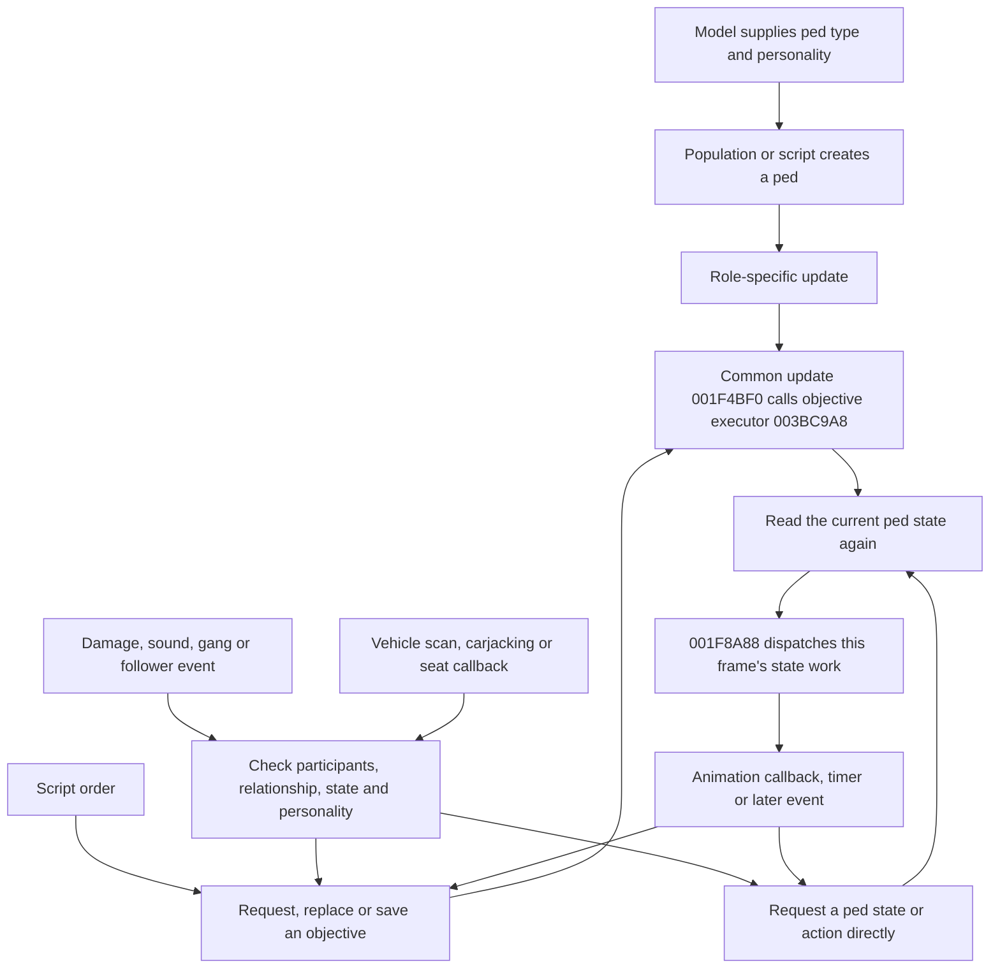
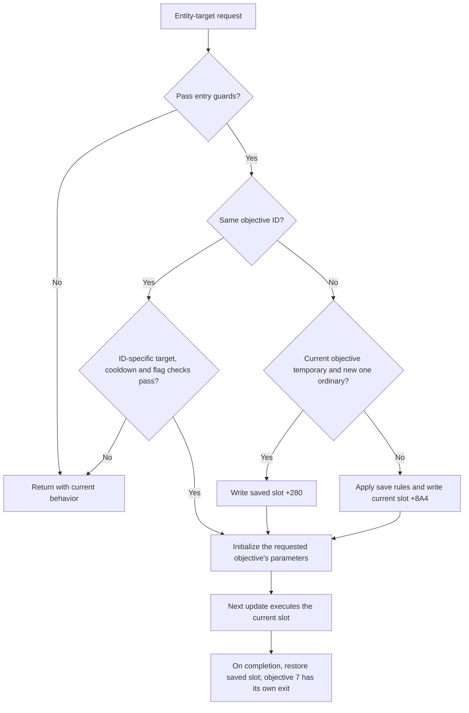
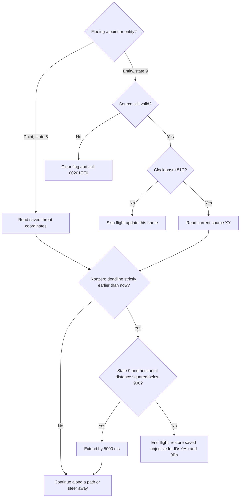

# VCS NPC implementation handbook

Start with the [overall behavior tree](vcs-npc-overview.md) to see what happens on the street. To implement one branch, identify the **actor, stimulus, current objective and current ped state**. The driver, carjacker, passengers and pedestrians beside the car can make separate decisions during the same frame.

| Implementation question | Evidence and decisions |
| --- | --- |
| Which tests does a model's personality pass? Why do two listeners respond differently? | [Personality and type tables](vcs-npc-profiles.md), [threat selection](vcs-npc-reactions.md) |
| Who spawns, follows, talks, seeks an activity, or returns to ambient control? | [Population, activities and script ownership](vcs-npc-activities.md) |
| Who hears a shot, evades a bullet, takes damage, or assists a leader? | [Reactions](vcs-npc-reactions.md), [gunfire perception](vcs-gunfire.md) |
| How does an NPC pursue and fight a chosen target? | [Combat execution](vcs-npc-combat.md) |
| What happens to the original driver, passengers and pedestrians in a car's path? | [Vehicle decisions](vcs-npc-vehicles.md), [vehicle impacts](vcs-vehicle-impact.md) |
| How do officers, medics and firefighters select and leave assignments? | [Emergency services](vcs-npc-services.md) |
| What happens when someone is held at gunpoint or catches fire? | [Gun threats and fire](vcs-npc-special.md) |
| What interrupts an action and what resumes afterward? | Objective arbitration below, [wait actions](vcs-npc-wait.md), [state and objective dispatch](vcs-npc-dispatch.md) |

## How one update fits together

Arrows show calls or data dependencies. Vehicle updates, ped updates, script commands and callbacks run at their own entry points. Log both the stimulus and whether the actor accepted it. A vehicle scan can request flight while the pedestrian's current state prevents the transition.

## Objective arbitration and restoration

The entity-target setter is `003BB670(ped, id, target)`. Position-based and untargeted requests have separate entry points. Offsets below are hexadecimal and relative to the actor.

| Step | PS2 behavior |
| --- | --- |
| Entry guards | Reject a null target, states 39h/3Ah/20h, bit 9 at +8 on the object returned by virtual call +70h, a nonzero ID already in the saved slot, or self-targeting. With ped+858 nonzero, allow only 8, 9, 15h and 16h. |
| Repeated request | For IDs 8/9/32h, reject an unchanged target at +8A0. A different target can also be rejected before +6D4 expires when the old reference exists and 002FCE00 succeeds. Vehicle objectives compare their own reference at +484. A repeated carjack event need not restart the pursuit. |
| Save or replace | 003BB4A0 recognizes temporary IDs 10h/11h/12h/1Dh/26h. An ordinary request during a temporary objective writes +280 and still initializes the new parameters. Other transitions call 003BB408 or 003BB450 to decide which previous IDs can be saved. There is one saved slot. |
| Bind target | IDs 8/9/25h/32h update target references including +6B4 and register them for cleanup. IDs 10h/26h/29h use 00219688 to bind a vehicle. Track the acting ped, target ped and target vehicle separately. |
| Complete | 003BC8F8 returns on current ID 0. For ordinary nonzero IDs it promotes +280 and clears the saved slot. ID 7 clears the current slot and can request 10h against the associated vehicle. Clearing the target reference has exceptions for IDs 10h/11h/12h and state 3Bh. |
| Change ped state | 00219340 performs exit cleanup, writes +8C4 and notifies virtual call +80h when the state changes. Leaving 0Bh clears a reference and route. Entering 11h invokes an extra callback. 00392F10 reads saved state +8C8. State 2Dh blocks immediate restoration, and 2Eh requires an additional flag. |

**Carjacking walkthrough.** With the same driver, issue a carjack, let the exit animation begin, then repeat the request against the same target. Observe current objective, saved objective, bound entity and ped state separately. For an approaching vehicle, repeat the same trajectory with a pedestrian walking, sidestepping (1Fh) and diving (30h). The latter two skip the repeated evasion request. A dive leads into the fall and get-up sequence before normal activity resumes. [Vehicle branches](vcs-npc-vehicles.md)

## When flight actually ends

00205C20 checks whether the actor can flee and the entity exists. On acceptance it sets movement 4 and state 9, records the source and writes +558. A duration below one writes zero, otherwise the deadline is the current clock plus the duration. 00205DF8 updates flight from both a location and an entity.

After cleanup, if the state is 1 or 5 and a random low bit is set, the original calls 0020ED50 with 3 or 14h depending on whether the previous movement level was below 3. At deadline equality flight continues. One tick later, entity flight at 29.9 units extends, while 30.0 allows cleanup. At the same distance, expired point flight takes the cleanup path.

## Evidence and limits

The target is the US PS2 executable `SLUS_215.90 (VCS)` in Ghidra MCP. Its SHA-256 is `3b43be57d60a29df35e41504d67bbf728d5ce2fc5aab6bbf928cbbc5963fe547`. Eight-digit addresses denote virtual addresses. Ghidra's float-pointer rendering can display integer ID 8 as `1.12104e-44`. Check the raw 32-bit operand in the dispatch instruction and multiply float-array indices by four for byte offsets.

The local gta-reversed comparison uses revision `04c5b664`. In `source/game_sa/PedIntelligence.cpp`, the event scan and handling calls suggest where to look for perception and execution boundaries. Equal-priority handling in `Events/EventGroup.cpp` suggests competing-event tests. The gun-aim response in `Events/EventHandler.cpp` suggests testing a target already in flight. SA's decision-maker method is a call wrapper in this revision. Thresholds, ordering and state IDs in the handbook come from VCS evidence.

The dispatch appendix accounts for every slot in the two identified jump tables. Shared exits, callback-driven transitions and unresolved cases are marked. A reachable table slot establishes where execution would go for that input. Establishing that ambient actors enter it also requires a producer and its guards. Earlier observations from PCSX2 and MTA are distinguished in the [field notes](vcs-street-ai.md).
