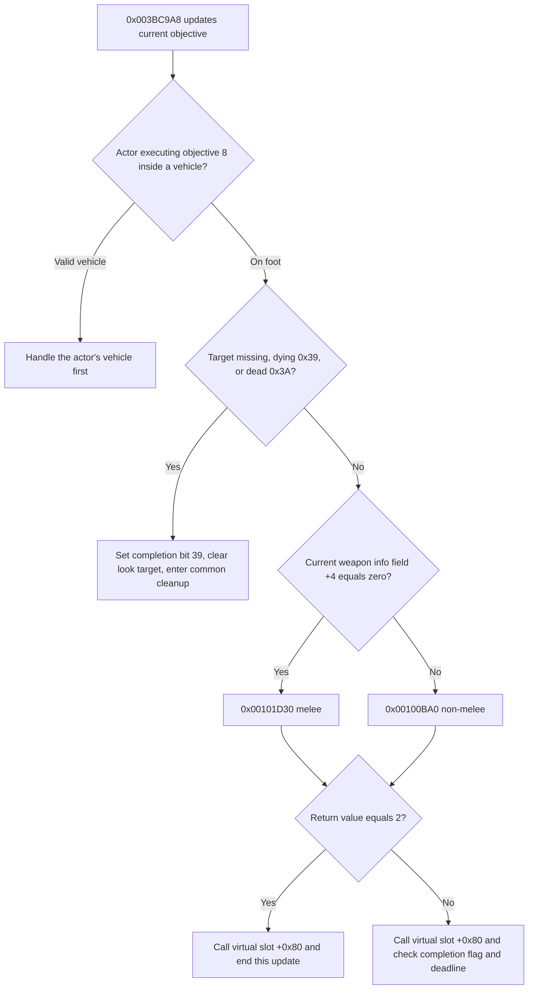
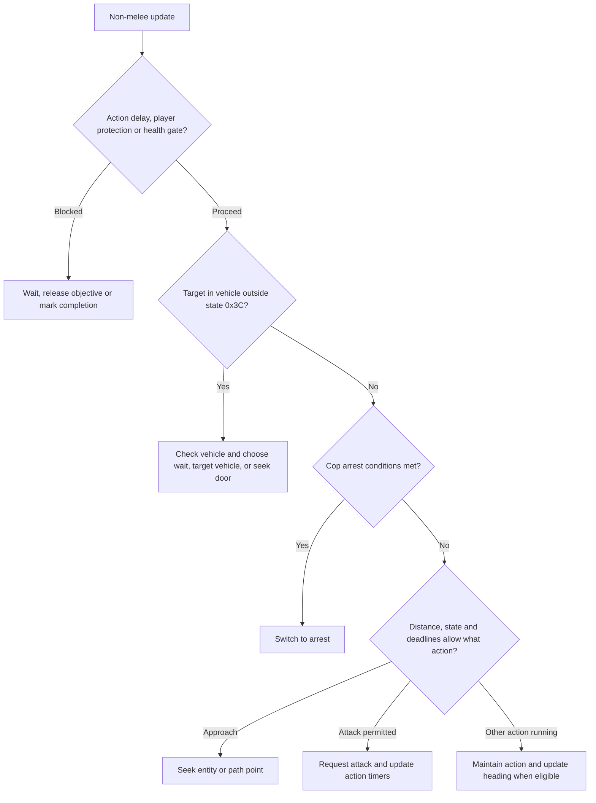

# Executing an attack objective

Start here when the NPC already has a target. The [reaction selector](vcs-npc-reactions.md) describes how hits, gunfire and witnesses assign objective 8. All addresses refer to the US PS2 `SLUS_215.90 (VCS)` program. Distances use game units, and timestamps use milliseconds. An attack animation can finish while the objective continues on the next update.

## Per-frame dispatch

Instructions at `0x003BFB74–BB4` read the signed current slot at `ped+0x789`, index the 0x1C-byte weapon records at `+0x574`, and call `0x002CEA70` to classify the weapon through its info record. Both executors use three-dimensional separation. Keep the actor state (`+0x8C4`), move state (`+0x8D4`), objective ID (`+0x8A4`) and target entity (`+0x8A0`) as separate inputs.

## Melee executor 0x00101D30

| Stage | Conditions and observable output |
| --- | --- |
| Existing action and player overrides | The executor distinguishes a player target and evaluates `0x00219A78`. Special world/player flags let certain ambient cops and gang members switch to weapon 0x13, set combat flags, stand still and return 1. Otherwise, `now < +0x6C0` with the bypass bit clear also makes the actor stand still. An arrested player (0x41) and player attack-inhibition flags can stop ordinary progression. |
| Backing away from the player | In the special case where `0x00219A78` returns zero, compare squared distance with 24.5, 49 and 98. At d² < 24.5, an actor outside state 8 flees the player's sampled position for 3000 ms in move state 5. At 49 < d² ≤ 98, stop and face the player. Above 98, approach with radius 7. Apply these tests only inside this branch. |
| Health and approach radius | A target with health ≤ 0 sets actor bits 39 and 40 at `+0x1C8` and returns 0. Start the normal working distance at weapon-info `+8 × 0.2`. Weapon IDs 2–11, other weapons and a target entering a vehicle modify the approach and attack thresholds. Actor state 0x11 adds 1 to the approach threshold. |
| Occupied vehicle | For a target in a vehicle outside state 0x3C, examine the vehicle and actor state. Some cop paths arrest or use a vehicle-specific action. On ordinary approach, write door ID to `+0x8F2`. The driver maps to 10 and the first three passenger slots map to 8, 11 and 9. `0x00303800` finds the door position, `0x0020B460` starts seeking it, and move state becomes 4. Existing carjack and attack states have early returns. |
| Pursuit on foot | After `0x001024E4`, compare the approach threshold and working distance, subject to flight state and action flags. A direct approach uses `0x00204038` with the target entity. The pathfinding branch uses `0x00307900` and related helpers to select an intermediate point before `0x00203E90` seeks its position. |
| Request an attack | `0x0010262C` excludes targets getting up (0x2E) or being dragged from a vehicle (0x3C). Fleeing, a posture that must end first, or a busy action controller can defer the request. On the accepted path the actor stands still, calls `0x001D0970(actor,target)`, turns toward the target and requests two action timers. This call site supplies random parameters 0–499 and 100–1499 ms. The timer helpers apply their own overrides. |

## Non-melee executor 0x00100BA0

- **Range.** Weapon-info `+8` supplies range R. One approach radius starts at R/3 when actor `+0x858 == 0`, otherwise at R. Vehicle transitions, posture and police branches can override it. Against a vehicle occupant, the ordinary attack-on-vehicle branch requires a passed timer and **3 < d < R**. Later timing decisions also inspect the vehicle's horizontal speed and direction. Other paths can keep approaching a door.
- **Target on foot.** At `0x00101308` the ordinary action request requires `now > +0x6D0`, d < R and target state other than 0x2E. State 0x3C has separate handling. An incompatible posture first calls `0x0030A468` and returns 1. The permitted branch calls `0x001D0970` and virtual slot `+0x7C` on the same target. Prior state and distance affect both requested timers. When `+0x81C` has passed, the frame tail updates desired heading `+0x8E4`.
- **Police arrest.** Against a player on foot the ordinary non-melee distance test is d < 2. The melee executor uses working distance < 1.5. Officer `+0x91C` with a fallen target (0x2D) can increase the threshold to 3.5. Officer state 0x11 in the non-melee executor selects 5. The target also needs an unexpired `+0x6C4` or state 0x3C. Successful dispatch calls `0x00327478`. The police update has additional [arrest entry points](vcs-npc-services.md).
- **Timing.** `0x00203BA0` sets `+0x6D4` only after the old deadline has passed. `0x00203A98` sets `+0x6D0` after the previous value expires, using the later of now and `+0x6D4` as its base. Actor fields `+0x4F0/+0x4F4` can supply an overriding duration and random increment. Starting both timers independently at the current frame shortens the interval.

## Interruptions, completion and verification

At `0x003BFBBC–BDC` only return 2 selects the immediate frame exit. Values 0 and 1 use the same virtual call and continue to `0x003C0F7C`. A target with zero health illustrates the distinction. Melee returns 0 and non-melee returns 1, but both write the same completion bits.

| Scenario | Expected observation |
| --- | --- |
| Remove the target, then repeat with target state 0x39 or 0x3A | Caller sets `+0x1C8` bit 39, clears the look target and skips both executors. Compare with health exactly zero in a nonterminal state to observe the two return values. |
| Hold the clock exactly at the deadline | Ordinary attack requires `now > +0x6D0`. A nonzero objective deadline `+0x6DC` must be strictly earlier than now for timeout cleanup. A zero deadline admits continued execution while the completion flag is clear. |
| Expire the objective while fighting | An ambient actor on foot with objective 8, state 0x11 and a living ped referenced by its current action controller can renew a nonzero deadline for 2000 ms. Otherwise ordinary cleanup calls `0x003BC8F8` to handle the objective. Eligible ambient actors resume wandering in one of eight directions, then release targeting and look state. |
| Enter arrest or hit a special vehicle branch | Record return 2, the virtual `+0x80` call, and the absence of common deadline processing on this frame. A separate in-vehicle arrest branch in `0x00101D30` returns 0. Use the state write and caller path together. |
| Change weapon while keeping target and distance fixed | Switching weapon-info `+4` between zero and nonzero switches executors. Compare d = R and d just below R, as well as get-up and dragged-from-car states. Record both timers, current state, entity reference and animation request. |

These findings come from static PS2 control flow. Individual weapon animation controllers, posture flags and special world-mode flags still require local tracing. For SA comparison, gta-reversed revision `04c5b664`, `source/game_sa/Tasks/TaskTypes/TaskComplexKillPedOnFoot.cpp`, manages the lifetime of its target reference. Its `MakeAbortable` and `ControlSubTask` methods forward to SA game functions.

## MTA execution

Traffic chooses an MTA inventory counterpart for the original VCS weapon. The importer reads the PS2 weapon range from GAME.DTZ manager slot 0x28, then manager+4 and record+8. A VCS attack task supplies the range and approach radius to HLC. The syncing client checks three-dimensional separation, cover, get-up/drag actions and linked action timers. The server asks the syncer about reachable pedestrian links and can choose an intermediate sidewalk node when the target is behind an obstruction. Repeatedly hitting a live target can renew ambient melee for 2000 ms. Host inventory, native combat playback and path search budgets are MTA adaptations. [Implementation and tests](vcs-npc-implementation.md)
