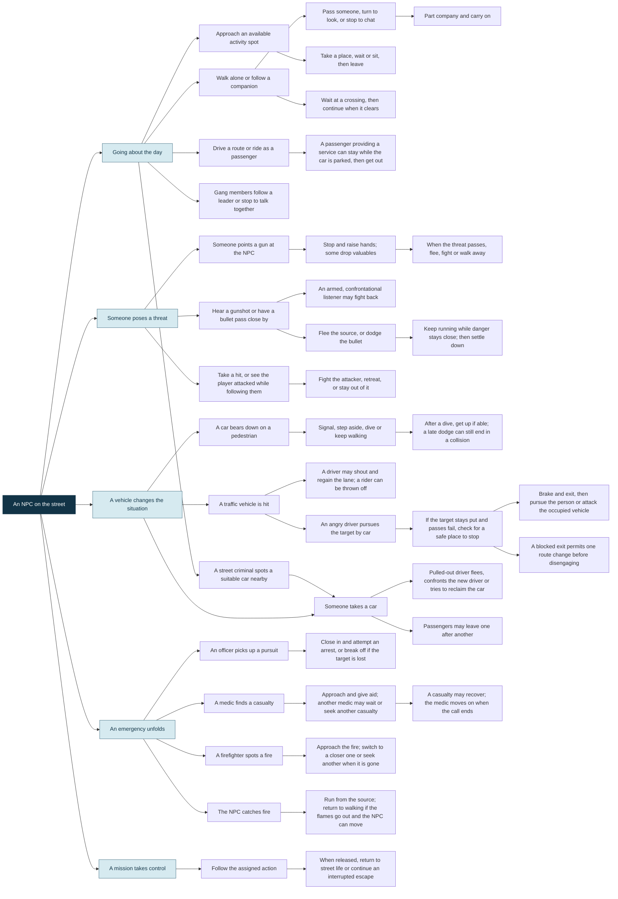

# What NPCs do in Vice City Stories

Follow one person through the tree. During a carjacking, for example, the driver may fight for the car, the passengers may climb out, and a pedestrian in front of the car may dive away. Each reacts to a different part of the same incident.

[Port implementation and verification guide](vcs-npc-implementation.md) · [Open the full-size behavior tree](vcs-npc-overview.svg)

## How personality changes the outcome

- **A frightened pedestrian can keep running after the first scare.** If they are fleeing a person or vehicle that follows them, staying close can prolong the chase. A driver fleeing the spot where they were dragged out can keep running from that spot even after the stolen car moves away.
- **A quick temper can change what happens after a carjacking.** A driver who would fight may still have to finish climbing or falling out first. By the time they get up, the person behind the wheel may have changed.
- **Being nearby and being a companion lead to different choices.** A willing follower can defend the player against an attacker. Other pedestrians may hear the shot, dodge a bullet, run away, or continue what they were doing. Gang members can also come to regard the attacker's group as hostile.
- **Work can be interrupted.** A medic approaching a casualty can flee a threatening player. At a casualty, one medic can give aid while another waits. If the casualty recovers first, the medic can move on. An officer whose target escapes can leave the pursuit and return to the patrol car.

## Three scenes to read across the tree

| What happens | What the people involved may do next |
| --- | --- |
| A player fires past two pedestrians. | One hears the shot and runs from the shooter. Another, farther from the shooter but close to the bullet, may dodge. Someone actually hit responds to the attacker and may fight back. |
| A car approaches someone crossing the street. | The pedestrian may gesture, sidestep or dive. A successful dive leaves them on the ground briefly before they rise. If the car reaches them first, they can still be hurt. |
| A player drags a driver out of a car with passengers. | The driver may shout, flee the spot, challenge the new driver or try to take the car back. The passengers can start leaving at different times while the driver's reaction is still playing out. |

## Debugging an individual pedestrian in game

Enter `/trafficdebug` to show overhead labels for traffic NPCs in view. Enter it again or use `/trafficdebug off` to hide them. The `road`, `ped`, and `boat` filters select the underlying path network. All three modes show labels for drivers, passengers, and pedestrians.

- Labels and path target lines use the 3D distance between the NPC and the local player. In the same interior and dimension, they are fully visible within 12 metres, fade between 12 and 35 metres, and disappear at 35 metres.
- The first line shows temper and fear from PEDSTATS. When temper exceeds fear, “Hot temper” appears in red. The carjacking response uses the same comparison to decide whether the driver gets angry.
- The second line shows the behavior, the HLC task name used in code, and its execution phase, for example `fight > killPed`. During conversation it shows the current gesture or listening phase. For seating it shows approach, turn, and sit phases. “Awaiting sync” means the executing client has yet to report a sample.
- The red bar in the black frame shows current HP relative to the character's configured spawn health. A white bar appears when armor is above zero.
- A solid cyan line and cross mark the point the executor is moving toward. During a detour, a faint dashed line connects the temporary point to the subsequent walking target. Waiting and stationary animations have no movement line.

Look under `mods/deathmatch/resources/[traffic]`. Search for the task name from the label in `npc_hlc/tasks_c.lua` to find its `performTask` handler. Pedestrian and vehicle avoidance decisions are in `npc_hlc/traffic_pedestrians_c.lua`. Conversation and activity phases are in `npchlc_traffic/ped_social.lua` and `ped_activity.lua`, respectively. If a spectator and the controlling client see different targets, check the subscription, syncer, and task revision in `npc_debug_s.lua`, then check the execution snapshot in `control_npc_c.lua`.
