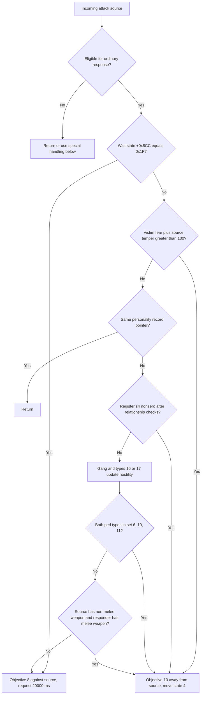
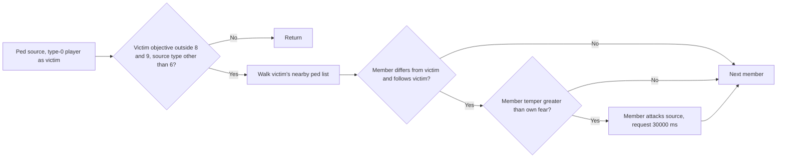
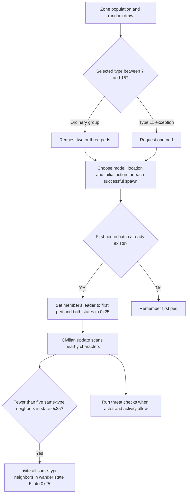

# Hits, witnesses and threat responses

US PS2 `SLUS_215.90 (VCS)`. Objective 8 requests an attack on a specified character and objective 10 requests flight from one. The objective executor determines later animation and movement. To reproduce one decision, record current ped state `+0x8C4`, objective ID `+0x8A4`, target entity `+0x8A0` and objective deadline `+0x6DC`.

## Direct attack response

`0x002201A0` takes the reacting ped and the source entity. Callers include weapon paths at `0x002C6B54` and `0x002C8654`. Damage handler calls at `0x001D8A34/6C` also send other passengers or the driver through the reaction selector. Track the responder, injured party and source separately. The diagram follows an ordinary on-foot responder after the entry gates.

| Order and evidence | Inputs, conditions and effects |
| --- | --- |
| Entry at `0x002201A0` | If creation flag `+0x8F4 == 1`, objective 8 already targets this ped source, clear then request 20000 ms. State 0x11 or ped type 0 subsequently returns. An actor already fighting can therefore refresh its timer first. |
| Driving state 0x37 | A vehicle path checks driver identity, vehicle fields and cruise task before rewriting vehicle control and returning. The ordinary gate calls `0x001FD9E0`. Creation flag 2 requires `+0x1C8 & 0x40000`. Return if the leader at `+0x2A4` is the source or the player. The normal personality path needs a ped source. |
| `0x00220420–444` and preceding gates | Special posture bits at `+0x1C8` can call `0x0030A150` for a timed animation or stamp the current time and return. Wait state `+0x8CC == 0x1F` calls `0x0020EB78` and goes directly to objective 8. |
| `0x0022044C–4B8` | Signed byte loads read source temper at personality `+0x17` and victim fear at `+0x16`. If fear > 100 − temper, flee before comparing record pointers. If the source's current weapon tests as melee, request speech 0x8E on this branch. |
| `0x002204C0–4EC` | Read the source's 16-bit relationship mask `+0x79C` using shift `(responderType - 7) & 31`. If the bit is zero and `0x00219A78` returns nonzero, clear s4. The next branch tests s4. Ghidra shows an incoming `unaff_s4`; paths retaining that register require verification at their callers. The helper checks player identity, nearby characters within 30 units, weapons and referenced targets. |
| `0x002204F0–640` | `0x0020C320` recognizes gang types 7–15. Types 16 and 17 also call `0x00307550`. Then classify both participants and their equipped weapon slots. `0x002CEA70` resolves weapon info and tests its `+4 == 0` field for melee. |
| `0x003BB3D8` | Zero clears the objective deadline. A nonzero duration writes now + duration only when the old deadline is strictly earlier than now. Requests in this chart can leave an existing future deadline intact. |

## Follower assistance and gang hostility

- **Follower assistance.** The only direct cross-reference found for `0x0030A520` is `0x00220160`. Instructions at `0x00220130–158` require a type-0 victim and a ped source. The callee can resolve a vehicle to its driver but this caller constrains the reachable input. The victim's nearby array starts at `+0x6F8`, count at `+0x77A`, member's leader at `+0x2A4`. This path checks that relationship without a separate sight test.
- **Hostility propagation.** `0x00307550` skips a source equal to the leader and checks mission flags. Types 13 and 15 have player exceptions. Outside current objectives 8/9, an eligible source resolves to a ped or vehicle driver. If it is the player or a gang ped, OR its type bit into responder `+0x2AC`. The routine also updates the same bit on qualifying ambient neighbors of the same type, excluding self and testing `0x0020C400`. This mutation influences later selection; the write alone does not assign an attack objective.
- **MTA adapter.** `notifyWitnesses` in `npchlc_traffic/ped_ai.lua` uses reports from the syncing client to drive ordinary witnesses and allies. Independently exercise a bystander who sees the incident, a same-gang member, and a ped that actually follows the player.

## Heard gunfire

Threat bit `0x100000` enters `0x002D9D18` from `0x002D9108`, subject to current state, objective and threat deadlines. Here d is horizontal distance to the selected source; the hearing scan uses three dimensions. See [gunfire and near misses](vcs-gunfire.md) for event creation and filtering.

| Order | Condition | Action |
| --- | --- | --- |
| 1 | Missing source or wrong entity type | Return. A listener with creation flag 2 and `+0x1D0 & 0x20000000000` uses `0x0030A150(ped,10000,1)` on the special branch. |
| 2 | Listener fear > lawfulness | At d < 30 flee the shooter via `0x00205C20` for 10000 ms, move state 5. Otherwise flee for 5000 ms in move state 4. |
| 3 | Previous test failed, temper > fear | With objective 0 and non-melee weapon the listener can attack via objective 8. A player shooter's `+0x918`, gang identity and flags can select 5000 ms of flight instead, move 4 inside 30 and move 2 otherwise. A listener already on an objective or holding a melee weapon instead flees for 5000 ms, using move 4 inside 20 and move 2 elsewhere. |
| 4 | Remaining listeners | Against the player first try `0x002DAA08(ped,1)`; success skips normal flight. Otherwise d < 30 flees the shooter entity for 10000 ms. At d ≥ 30 flee the sampled position for 5000 ms, move 2. The latter retains a coordinate when the shooter moves. |

## Police dispatch and individual response

Hearing, crime reporting and police deployment have separate update points. Gunfire world event 4 can register a zero-point crime. Civilian injury and police injury use different crime IDs. A type-6 source inhibits the follower-help path above. See [police pursuit and arrest](vcs-npc-services.md) for individual officer transitions.

| PS2 predicate | Result |
| --- | --- |
| `0x003AADA0` | Request undercover units when stars > 2. |
| `0x003AADB0 / 0x003AADE8 / 0x003AAE20` | SWAT, FBI and army respectively test for stars **equal to** 4, 5 or 6. Each also accepts its own override flag. At five stars the ordinary four-star predicate is false. |
| `0x003AAE58` | Request one helicopter at 3–6 stars. Either suppression bit in `wanted+0x18 & 0x3000000000000` returns zero. |

Crime queues, police presence, dispatch targets and aircraft control are covered in [wanted-system evidence](../mods/deathmatch/resources/%5Btraffic%5D/npchlc_traffic/wanted-evidence.md).

## Gang creation, gathering and wandering

- **Spawn.** `0x002B17A8` checks the police threshold first, then nine cumulative gang thresholds and zone conditions. The selection can fall back to civilian population. `0x002B45C8` returns a requested ordinary group size of 2 or 3, while `0x002B3B90` singles out type 11. Location validation, zone reselection and model availability affect realized spawns.
- **Membership.** `0x00211868` stores the first ped in later members' `+0x2A4`, marks `0x2000000000000` at leader `+0x1C8`, and registers a reference. Set both actors to 0x25. On successful path-node acquisition `0x00206568` writes 5, move state 2 and the eight-way direction. The state labels are `PED_WANDER_PATH` (5) and `PED_HANG_OUT` (0x25). Fixed territorial patrol routes require separate route or script evidence.
- **Inviting neighbors.** The 0x25 case in `0x002D8788` counts nearby same-type peds already hanging out. If count < 5 it visits the entire nearby array and sets **every** same-type wanderer in state 5 to 0x25. It checks the limit before the loop and does not assign a leader to invitees. Preserve the distinction between a group member and a passerby joining a gathering.
- **Hostile encounters.** `0x001EFFB0` uses each ped's dynamic mask at `+0x2AC`. When a gang ped hears a shooter of a different type it checks the shooter's type bit, with a separate pass condition for type 11. Success returns the **shooter's type bit**, dispatching to the entity-threat path in `0x002D9D18`. Source temper + listener fear > 100, or a police source, opens one route to 10000 ms of flight if listener flags allow it and `+0x858 == 0`. Other branches inspect weapons, source relationship bits and player state before potentially assigning objective 8. Dynamic writes from `0x00307550` affect later decisions.
- **Ambient criminal.** Type 18 uses the civilian constructor with `+0x900 = 1`. Its vehicle scan at `0x002D9860` uses a periodic `+0x904` counter and requires a controllable actor with no objective. Select an eligible vehicle at 3D distance < 10 and health > 800, subject to model, vehicle flags and occupancy. Set objective 0x12 with a 10000 ms request. After entry into the chosen vehicle, set the vehicle task and speed.

## Conversation and interruption

| Stage | Trigger and behavior |
| --- | --- |
| Find a partner | `0x001F16D0` checks controllability, no current objective, creation flag other than 2 and prior activity gates. For a wanderer in state 5, random ≥ 0.5 sets `+0x6CC` to now + 200 ms. The other branch checks nearby state-5 peds when this deadline has passed. |
| Eligibility | 3D distance strictly < 1.8, with `0x002FCE00` accepting both participants' heading differences (approximately 60° each, equality fails). `0x001F1C50` rejects self, target models 0x36 and 0x42–0x44, and certain actor states. Same types can pass here; different types have additional player, police, gang and type-18 exclusions. The caller also excludes type 10 on either side. |
| Start | At `0x001F1BD4/E4` both participants call `0x0020AAB0` with each other and the same duration, `10000 + (random low 16 bits % 4000)` ms. Each enters state 0x14, move 1, and looks at the other. `+0x6CC` holds their deadline; `+0x6C8` gets 3000 ms. Population-generated pairs at `0x002B5184/98` use 100000 ms. |
| Normal finish | `0x0020AB58` checks the partner, both states and deadline. It coordinates gesture animations 0x0E / 0x94 and speech 0x9C. Once a nonzero deadline passes, `0x0020ADA8` fades the gesture, drops the look target and restores state; `+0x6CC` then becomes now + 30000. |
| Partner interrupted by conflict | A partner leaving state 0x14 also ends the chat. If the partner now has objective 8 or 10 and a target, instructions `0x0020ABF8–0x0020AC1C` pass **the third party targeted by the partner** into `0x002201A0(self, thirdParty)`. The listener makes its own response decision. This is a witness entry independent of follower assistance. |

## Competing threats in one frame

1. **Pending slot.** `0x001F0B28` scans only with `+0x76C == 0`. If it finds a valid source it stores now + personal delay `+0x774` as the due time; otherwise it clears the slot. `0x001F0BB0` invalidates stale references. An incoming shot does not replace an already pending threat through this function.
2. **Scan order.** `0x001EFFB0` first tries position threat bit 0x800000 (`0x0020BFA0` searches world event 13 then 7), then shot event 4, then threat bit 0x2000000 (`0x0020C258` searches event 6 for a ped-class source, outer 3D distance < 20). Nearby peds and vehicle occupants follow. Each earlier branch has mask and eligibility tests, returning immediately on success. A civilian eligible for both shot and event 6 sees the shot first. The full set of producers for events 6, 7 and 13 remains open.
3. **Consumption.** `0x002D9D18` consumes only when `now > +0x770`. Full reactions require `+0x558 < now` and either no objective or `+0x1C8 & 0x40000`. On the restricted path, objective 4 or objective 8/9 directed at the player returns immediately. Other actors require `now > +0x6C8` before checking the pending event. Restricted reactions look at a shot source or turn toward a position threat and request 500 ms. Other threat bits can be consumed without a new objective.
4. **Subsequent activities.** `0x002D8788` dispatches current state, then calls the threat update if controllable and permitted by the current activity. Ambient peds next call `0x002D9860` and `0x002D9210`. The latter needs no objective, no leader, no leader flag and state other than 9 before scanning scene attractors. An objective set earlier that frame or an existing group relationship can therefore block an activity.

## Verification scenarios

1. Fix attacker temper at 60 and vary victim fear from 40 to 41. Only the second value takes immediate flight at the fear test. Repeat with shared personality pointers to verify the ordering.
2. Set follower temper equal to fear, then raise it by one. Compare following the victim player, following another ped and having no leader. Replace the source with a cop and trace the suppression branch.
3. Set gunshot horizontal distance to 19.99, 20, 29.99 and 30. Record target entity/position, timer and move state, then move the shooter after the reaction begins.
4. Issue two timer requests to objective 8, then test the explicit clear-before-renewal case. Record old and new deadlines alongside the clock.
5. Let two wanderers meet while varying headings, distance and type 10. Interrupt a chat by having a third party strike one participant and log the target passed by the other.
6. Compare four and five hang-out neighbors, then add two wandering same-gang peds. Capture state and leader before and after the batch invitation. Supply world events 4 and 6 in one frame under no objective, objective 4 and objective 8 toward the player. Log pending bit, both clocks, consumption and resulting objective.

For SA comparisons, gta-reversed revision `04c5b664`, `source/game_sa/Events/EventHandler.cpp::ComputeGunAimedAtResponse` and `EventGroup.cpp::GetHighestPriorityEvent` suggest tests for existing flight, friendly targets and simultaneous events. Its `DecisionMakerTypes.cpp::MakeDecision` forwards to the SA binary. The addresses above establish VCS-specific ordering. For the existing PCSX2 observation of model 26 entering fight state 17 after punches, and MTA regression commands, see the [street AI index](vcs-street-ai.md).
