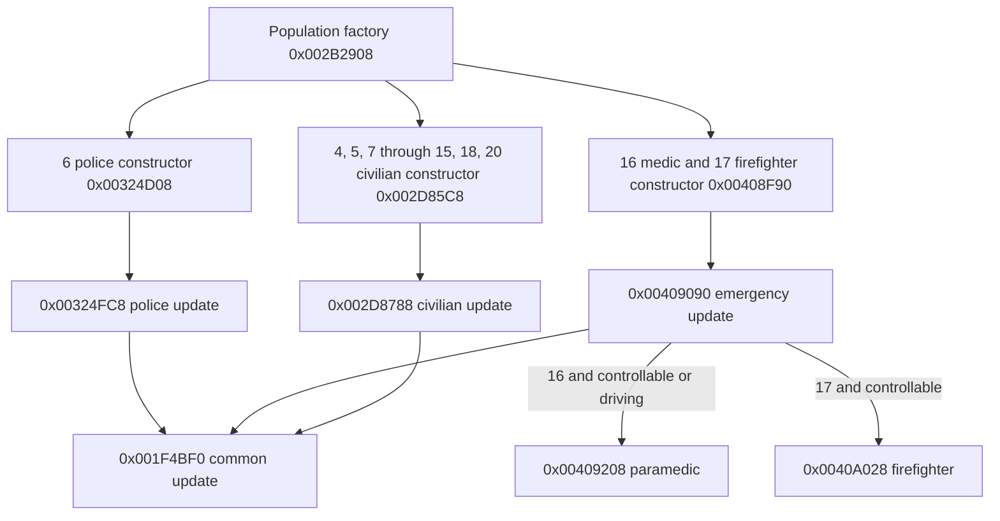
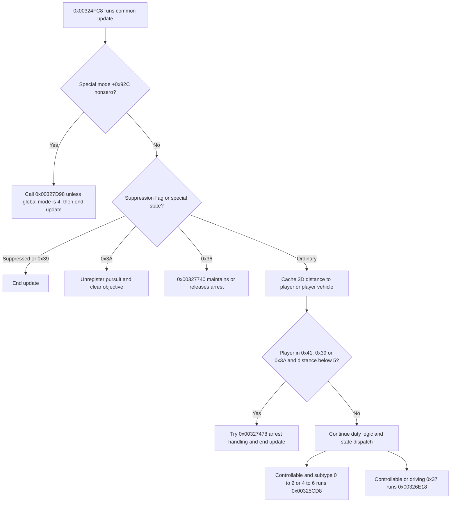
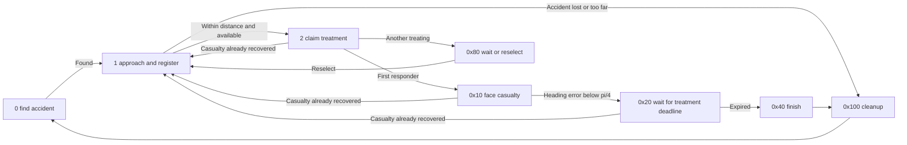
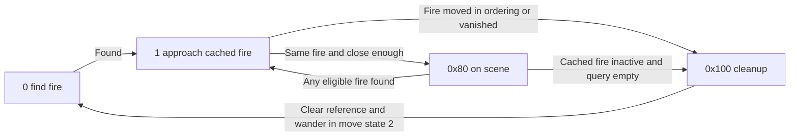

# Police officers, paramedics and firefighters

US PS2 program `SLUS_215.90 (VCS)`. The population factory chooses a class by ped type. Its per-frame virtual function determines which service logic runs alongside the common ped update. The same field offset can have a different meaning in each class.

## From ped type to update function

The factory allocates 0x950 bytes for a cop, 0x920 for an emergency ped and 0x960 for a civilian. Each constructor sets the vtable at `ped+0x5C`. Read the four-byte little-endian pointer at slot `+0x30` to independently verify dispatch.

| Role | Vtable base | Slot address → update | Construction |
| --- | --- | --- | --- |
| Police | 0x00490CE0 | 0x00490D10 → 0x00324FC8 | Type 6, subtype 0–6 at `+0x928`. Subtype 3 runs 0x003279C8 first. Subtypes 0 and 6 use different models but share a weapon initialization branch. |
| Paramedic / firefighter | 0x00491DE8 | 0x00491E18 → 0x00409090 | Types 16/17 select models 12/13 respectively. The constructor clears service phase `+0x904`. Vehicle crew selection at 0x002B3CA0 assigns type 16 for vehicle model 0xE3 and type 17 for 0xC2. |
| Civilian and gang | 0x00490840 | 0x00490870 → 0x002D8788 | The factory passes a model and ped type into the civilian constructor. Its independently referenced slot provides a cross-check for the other two tables. |

The controllability test `0x001FD9E0` requires state < 0x29, `ped+0x1C8 & 0x3000 == 0` and health > 0. The emergency update runs the common update first, then skips service processing if the entity suppression bit is set or the ped is dying (0x39) or dead (0x3A).

## Individual police update

- **Street pursuit.** On the nearby-ped scan path at `0x00325CD8`, an officer already executing objective 8 or 0xE, or created with a value other than 1, returns. A controllable, ambient type 18 or gang candidate is checked against the type relationship mask and its current flight target. If accepted, the cop gets objective 8 toward that NPC and the NPC gets 10 toward the cop plus a flag. Player pursuit uses separate registration at `+0x908`.
- **Enter arrest.** `0x00327478` checks controllability, target validity and an activity flag. The officer and target request speech events 0x6D and 0x6C. In ordinary entry the target becomes 0x41 and records the officer. Existing dying/dead states bypass that write. The officer becomes 0x36, clears the objective, faces the target and selects weapon 0x13. There is another close-range entry when the officer is in state 7, the approach step completes and objective 8 is active. It accepts distance < 2.5 with the player already in 0x41, or distance < 1.3 with the player in 0x3D/0x3B.
- **Maintain and release.** `0x00327740` maintains facing and schedules animation 0x97 for a valid arrest target. Loss of the target or departure from the permitted states calls `0x003271E8`. With `+0x908 == 1`, this removes the officer from the player's pursuit list, compacts it, clears the objective and handles return to the vehicle or departure according to vehicle association and distance. Death also calls the unregister function.
- **Further branches.** `0x00325CD8` contains vehicle-relative positioning, weapon-slot selection and a velocity-projection check at long range. `0x00327D98` and subtype 3 have dedicated paths. The chart identifies the pursuit and arrest transitions; exact firing frames require the corresponding [attack executor and action controller](vcs-npc-combat.md).

## Paramedic

The accident manager at `0x00716600` contains 20 twelve-byte slots. Each stores a casualty pointer, number assigned and number at the treatment stage. `0x00408CA0` first searches slots with treatment count 0, then slots with count 1. Each pass takes the smallest horizontal distance. A casualty must have health **exactly zero**, creation flag other than 2, and `casualty.z - searcher.z < horizontalDistance × 0.5`. Instructions at `0x00408D60–84` compare a signed height difference and retain the first slot on a distance tie.

| Stage at 0x00409208 | Conditions and action |
| --- | --- |
| Threat interrupts service | A controllable medic on foot can consume a due threat. If the source is the player with a non-melee weapon, flee that entity for 6000 ms, request speech 0x77 and return. A melee-equipped player source leads to objective 8. |
| On board near casualty | Requires a vehicle, vehicle field `+0x354 == 0`, and current objective other than 0x10. Nearest casualty horizontal distance < 25 and 3D speed < 0.01 cause a stop, objective 0x10 to exit and speech 0x8C. |
| Phases 0 and 1 | Assign objective 0x18 toward the midpoint of two casualty bone positions. Register slot and references. On reselection `0x0040A2B8` requires no associated vehicle or 3D vehicle-to-casualty distance ≤ 30. Inside horizontal distance 5, check casualty occupancy at `+0x6B0`. Advance when d < 4.5, unblocked, and either d < 1 or another responder is already treating. |
| Phase 2 | Health > 0 returns to phase 1. An eligible responder enters ped state 0x1B and requests speech 0x8B. First responder requests animation group 0x1A / animation 0xDF and calls the shared deadline helper with 2000 ms after its 500 ms call on this path. Another responder enters phase 0x80. Both increment the accident's treatment count. |
| Phase 0x20 | If casualty is valid and `+0x6C8 < now`, enter 0x40. A casualty flag at `+0x1C8 & 0x400000` suppresses revival. Otherwise health becomes 100, ped and movement state reset and the casualty requests speech 0x7C. |
| Phase 0x100 | Release accident reference, decrement assigned count, clear casualty and reset phase to 0. A medic on foot with no vehicle association selects one of eight wander directions. |

## Firefighter

`0x0040A028` calls `0x002BD520(0x0051D7D0,...,0)` to scan 40 fire slots with stride 0x40. It tests the active and exclusion bytes and selects the nearest horizontal position. In phase 1 it queries again. A matching result sets the destination to the fire position with approach parameter 1.0 and move state 4. An **independent final test** sets phase 0x80 when d < 5, so a changed nearest slot can first set 0x100 and then have that result overwritten. Phase 0x80 tests the cached slot and searches again. Any valid fire sets phase back to 1, and the actor requests speech 0x96. The query overwrites the distance output even though the caller initializes it to 30. The direct write that extinguishes a fire has not been traced to this firefighter update; the fire and vehicle writers are separate investigation points.

## SA comparison and verification scenarios

gta-reversed revision `04c5b664`, `TaskComplexTreatAccident.cpp`, separates achieving heading and CPR into subtasks. `TaskComplexArrestPed.cpp` and `TaskComplexExtinguishFires.cpp` provide related SA responsibilities. All phase IDs and boundaries above come from VCS static analysis. The scenarios below are proposed verification cases.

1. Send two medics to the same casualty. Record all three accident fields, each responder's phase and casualty health. Add a farther unclaimed casualty to distinguish pass ordering from distance alone.
2. Let a casualty recover before treatment. Separately set the revival-inhibition bit when the treatment timer expires. Check that neither case unconditionally writes health 100.
3. While a firefighter approaches A, introduce a nearer fire B within 5 units, then remove A. Record both writes in phase 1 and the cached fire pointer.
4. Put the same player in 0x41, 0x3D and ordinary running state. Test both sides of distances 1.3, 2.5 and 5. Kill an enrolled officer and check pursuit count and list compaction.

## Traffic resource implementation and verification

Start with `mods/deathmatch/resources/[traffic]/npchlc_traffic/ped_services.lua`. The two incident pools track the original model ID, world, assigned crew and number treating. Ambient `onPedWasted` registers a zero-health traffic casualty. Road population considers outstanding incidents at normal spawn opportunities, uses model 227/194 and chooses driver 12/13. The road driver switches to physical driving and uses the native seat-exit request once stopped. After leaving the vehicle, `traffic_ambient.lua` advances on-foot service tasks. A mission taking control, destruction, death, invalidation or a higher-priority reaction frees the reservation. The signed vertical check, the two-pass selection and the horizontal treatment distances are in `nearest` and `treat`.

MTA does not expose the PS2 accident and fire arrays. Ordinary traffic corpses fade during the last 400 ms of a three-second lifetime. A registered accident extends that lifetime only while a living crew is en route or a medic is assigned, up to 45 seconds from death. Exploded traffic vehicles also fade and are collected after three seconds. The adapter uses the road population spawn candidates and samples nearby burning peds/vehicles around exterior players. A Molotov event without an entity-bound fire remains in the adapter for 12 seconds. The responder follows the current fire, reports arrival within 5 m and releases the task when the fire disappears. The burning entity or fire owner determines when it goes out. The stationary medic faces the casualty and starts the PS2 CPR animation. At 0x00203A70 the helper only writes an expired deadline. On a fresh timer the 500 ms write therefore survives the following 2000 ms call. Phase 0x10 halves the heading error until it is below 45 degrees. Phase 0x20 requires the deadline to be strictly in the past. Travel, alignment and any existing deadline affect the total time. The adapter uses a fresh treatment timer and advances these phases on server updates. Headless casualties cannot be revived. The original inhibition flag has no MTA field equivalent.

In Ghidra open the USA PS2 executable and follow 0x0043BE00 to 0x00408DE0 (occupied accident slots), 0x00433890 (model count) and 0x0043C130 (road spawn). Dispatch requires at least two occupied accident slots, fewer than two ambulances counted, no active dispatch in the checked fleet field and more than 30000 ms since the previous successful dispatch. The spawn routine samples road positions around the player with a 110-unit parameter and checks clearance. These calls establish variation in placement. They do not establish a separate percentage roll for each death. Trace 0x00428C48, 0x00429930, 0x0042AD80 and the onboard branch of 0x00409208 for the stop and crew exit. The 25-unit horizontal limit and speed below 0.01 permit dismount. They do not identify a single parking coordinate.

In MTA the slot count, concurrent dispatch and cooldown use each dimension's exterior population. An existing ambulance can respond locally to one casualty. A new dispatch uses the traffic spawn scheduler. The driver searches up to 512 directed edges for an accessible lane point within 22 horizontal units and 5 vertical units of the casualty. That margin accommodates the driving task's arrival tolerance. After treatment the medic searches for another eligible casualty near the ambulance, then requests the original driver's seat and rejoins the road network. The lane search and timer granularity are port choices.

For vehicle ownership inspect `register`, `yieldDriver`, the seat events and the unclaimed-vehicle sweep in `traffic_road.lua`. A player can use any seat without releasing the traffic resource's ownership. Within observer range a player-used ordinary vehicle gets a 30-second empty parking grace period. The sweep checks actual occupants to handle disconnects. It also protects ongoing entry, crew duty and NPC reclamation. An unneeded empty emergency vehicle can be collected during the next sweep. Vehicles borrowed from another resource are excluded. Run `tools/check_vcs_traffic.py` for driver, passenger, missing exit callback, medic reservation and cleanup cases.

MTA 1.7 rejects `setElementHealth(deadPed,100)` and leaves the native wasted flag set. On successful CPR, the adapter creates a living ambient ped with the same VCS model, native skin, position, facing, interior and dimension, attaches HLC and its brain, plays the get-up animation and removes the corpse. Scripts should retain handles to their own mission actors. Mission-owned kills never enter this pool.

For police, inspect `pursueStreetPed` and the third relationship word exported by `tools/ped_ai_profiles.py`. For player arrests, `wanted.lua` owns the wanted change and emits server-only `onTrafficPlayerArrest` on the player with arguments `officer, previousLevel, targetState`. A gamemode can cancel it to handle custody itself. On an accepted living arrest, the officer faces the target and both roles request the original arrest speech. The server starts the Busted sequence, charges the level-specific fine unless free bail applies, removes weapons and armor, and returns the player to a police station. The wanted resource resets the player with reason `arrest` at the station transition. Entry into the driver's seat uses the 1.3 m gate. A server gamemode can export its equivalent of player state 0x41 through `setTrafficPlayerRestrained(player, true)`, then clear it with `false`. The general already-restrained gate is 5 m. For a wanted player dying within 5 m of a living officer, the wasted event notifies the owner with targetState `wasted` and preserves the normal death and respawn state. The corresponding living arrest emits `alive`. The special-mode path above remains a separate reference point. Ghidra at `0x00324D08` shows models 8 and 119 receiving weapons 4 and 0x13, models 9/117/118 receiving 0x19, and models 10/11 receiving 0x1B, each with ammunition 1000. GAME.DTZ weapon record +0x60 gives the weapon model ID. Its model definition +8 holds the uppercase CRC key for NITESTICK, BERETTA, UZI or MPLNG respectively. The server equips their MTA slot counterparts and switches the ordinary officer to the pistol during arrest.

### Where to find and rebuild the files

- Read the ambulance/fire crew selection at `SLUS_215.90:0x002B3CA0`, the paramedic updater at `0x00409208`, the firefighter updater at `0x0040A028` and the arrest handler at `0x00327478` in Ghidra. Check each field against its class vtable before naming it.
- Use `tools/import_vcs_traffic.py --help` for the original GAME.DTZ plus GTA3PS2.IMG street-model converter. Include the `--street-peds` converter path when regenerating `ped_models/street.img`, its model/group tables and `ped_models/street.ifp`. Models 12/13 map to SA host skins 274/277. The group 26, ordinal 0xDF CPR and group 0, ordinal 0x97 arrestgun clips are selected in `tools/vcs_traffic_animations.py`.
- Run `py -B tools/ped_voice_import.py "<unpacked USA disc>"` to rebuild the resource's catalog and WAVs. The script runs the original `0x001C2448` speech selector per model/event and decodes AUDIO/SET0/SFX2_PS.SDT/RAW. The cooldown table starts at `0x00485AA8` with 24-byte records. The paramedic has eight 0x8B and eight 0x8C samples, the police actor has 0x6D samples and model 0 has five 0x6C samples. A requested event with no bank-2 mapping for that model remains silent.
- Run `py -B tools/ped_services_check.py`, `py -B tools/check_vcs_wanted.py` and `py -B tools/ped_voice_check.py`. The first covers assignment, second-responder takeover, world changes and interrupted/inhibited treatment. The second covers normal running, car-entry distance, already-restrained distance and a canceled arrest.

On the native MTA 1.7 server, an isolated case in dimension 728 produced a model-23 casualty at zero health, one treatment request, one revived request and a living model-23 replacement at 100 HP. A burning vehicle followed by repair produced one on-scene request and released the firefighter. On the same server, an officer and model-90 gang member acquired reciprocal objectives 8 and 10. No real player was connected during these runs, so these measurements do not verify client-side playback, CPR frame blending or a player's custody presentation.
