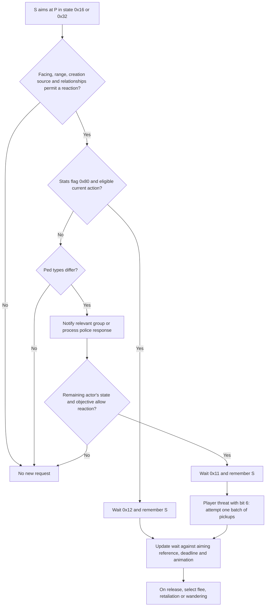
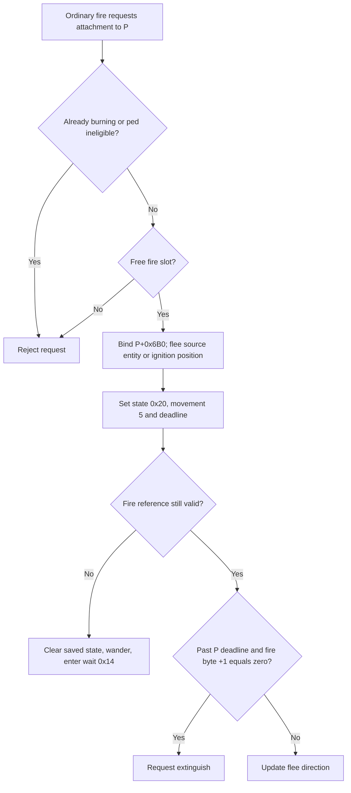

# Gunpoint reactions, hands up and burning

US PS2 VCS keeps body state at +0x8C4, wait action at +0x8CC and objective at +0x8A4. Track the aiming actor S, threatened NPC P and P's reference to S separately.

## Gunpoint

| Order | PS2 decision and effect |
|---|---|
| 1. Producer | `0x001F8D98` reads P from **S**+0x820 and requires a live reference to a ped entity. Facing test `0x002FCE00` compares P's heading with the horizontal bearing toward S, allowing wrapped angular difference strictly below approximately 120° (f12=0x40060A92). `0x001F8DE4` calls `0x0021FB38(P,S)`. Another producer is `0x002C4348`. |
| 2. Eligibility | Return for player P, failed `0x001FD9E0(P)` (requires state <0x29, flags +0x1C8 & 0x3000 clear and health +0x4E4 >0), creation source 2 without +0x1D0 bit 41, P+0x2A4 equal to S, existing wait 0x11/0x12, or horizontal squared distance **>225**. Types 0x0D and 0x0F ignore player S here. If P+0x2A4 references the player, return; for another reference call `0x00181ED8(P)`. |
| 3. Stats priority | If stats(P)+0x14 & 0x80, P is outside states 9 and 0x16 and outside state 0x10 with a false weapon predicate `0x002CEA70`, request wait 0x12 (animation 0x9D) for 3000–5999 ms. Queue speech 0x76 at now+1500 if +0x7A0 is empty. Store and register S at P+0x6B4, set movement 0, return. |
| 4. Other types | Continue only if P and S have different types. Gang types 7–15 and types 0x10/0x11 first call `0x00307550(P,S)`. Police P facing player S calls the wanted subsystem with parameter 2. If +0x1C8 & 0x120000000000, call `0x0030A150(P,1000–2999,0)`; police exit the ordinary reaction path. Other P return in state 0x10 with false weapon predicate, or state 9 with non-player S or S already the flee source. State 0x16 and objective 8 also skip. Otherwise sample 3000–5999 ms for wait 0x11 (animation 0x9C), request speech 0x76, register S and set movement 0. |
| 5. Dropping pickups | Only the ordinary wait-0x11 branch checks player S and P+0x1D0 bit 6. Draw R=100–299 and split into n=floor(R/40)+1 portions. For each portion, sample horizontal offsets around P and check ground height. On success call `0x001DDB38` with pickup type 8 and amount floor(R/n)+(rng & 7). Clear bit 6 afterwards. Repeated aim alone cannot repeat this drop. Independent state 0x15, PED_MUG, targets the common state-dispatch exit. The civilian scan at 0x001F16D0 can request objective 0x25 at 0x001F1A40. Its completion writes bit 6 on the mugger at 0x003C0E9C–0x003C0EB0. Follow the [ambient mugging chain](vcs-npc-activities.md). |
| 6. Ending the wait | `0x0020F638` looks up the appropriate animation for wait 0x11/0x12. Release if ped S has cleared S+0x820, P enters state 9/0x10, now passes the deadline or the animation disappears. Only non-nullity of S's aim slot is checked here. Compare switching aim to another ped with actually lowering the weapon. On release, when S remains a ped, P is outside 9/0x10 and bit 41 is clear, test **P.fear > 100−S.temper**. True requests 0x0A against S, movement 4 and speech 0x8E. Otherwise, with false weapon predicate, inspect S+0x79C bit indexed by (P.type−7)&31. Set bit clears the objective and selects one of eight wander directions; clear bit requests 8 against S and calls `0x003BB3D8(P,20000)`. With true weapon predicate, wander if stats flag 0x80 is clear; otherwise request 0x0A and update movement according to type. Bit 41 has a separate branch through `0x0030A468/0x0030A150`. |

Test ranges 14.99, 15.00 and 15.01. Only the last fails the distance gate. With S.temper=60 and P.fear 39/40/41, only 41 takes the strict flee comparison. Repeating the stimulus during the wait should preserve its deadline. Separate state 0x40, PED_HANDS_UP, checks its animation at `0x001F8AB4`: maintain 0x9D with stats flag 0x80, else 0x9C. Both paths request speech 0x76 only when starting the missing animation. The gunpoint producer above writes a wait action.

## Burning

- Ordinary ignition `0x002BD7C8` checks ped+0x6B0 and `0x001FD9E0(P)` before allocating a slot; failure returns null. On success bind the fire. With source S call `0x00205C20(P,S,10000)`; without S call `0x00205A68(P,P.xy,10000)`. For a non-player clear objective, set +0x558=now+10000, clear +0x1C8 bit 30, set movement 5 and request state 0x20 at `0x002BDAD0`.
- State update `0x001F8ECC` skips the player. If the fire exists, P+0x558 < now and fire byte +1 is zero, call `0x002BE8D0`. Otherwise read XY from the flee-source entity or saved position and update via `0x00205DF8`. Once the fire reference is null, call `0x002190C0(P,0)`, `0x00206568(P,0)` and `0x0020ED50(P,0x14,…)`.
- Alternative entry `0x002BEE00` extinguishes existing fire first, then creates one with byte +1 set. A non-player flees its own XY for 10000 ms and enters 0x20 at `0x002BEFC4`. Compare two fires with equal deadlines: ordinary expiry triggers strictly after the timestamp; one with byte +1 set needs another termination path. Entity-objective setter `0x003BB670` rejects a new request while burning; test objective 8 arriving during this state.

These newly traced branches have static Ghidra evidence. In MTA, aim needs the aimed-at entity and release time; weapon discharge and damage have separate event producers. Compare SA's `Events/EventHandler.cpp::ComputeGunAimedAtResponse` for test design involving an existing flee task. [Gunshots, damage and witnesses](vcs-npc-reactions.md)

## Runtime binding

In Ghidra open `SLUS_215.90 (VCS)`, decompile `0x0020F638` and follow cases 0x11 and 0x12 through `0x0020FBF8`. The common exit looks up the same animation association again and applies a negative blend delta (−4). The ordinary unarmed wander branch clears the objective, samples one of eight headings and calls `0x00206568`. In MTA, `PedSpecial` hands that heading to `TrafficAmbient.resumeWander`. The scheduler probes reachable sidewalk nodes from the ped's current position, even if the entire wait occurred between scheduler visits.

The street IFP converter emits `handsup_wait` and `handscower_wait` from the original keyframes, extending the last pose to six seconds for finite playback. The client releases the pose on server cancellation, stream-out or resource stop. The shorter vehicle-evasion clips keep their original durations. Run `python -B tools/ped_objectives_check.py` for the gunpoint branches and animation lifecycle, and `python -B tools/check_vcs_traffic.py` for the return to a reachable waypoint.

Player target-change events feed a server-owned aim reference. Raising a weapon at a second actor preserves the first actor's non-null aim check until release or deadline. The owner may report a lost animation against its current revision. Standard PS2 associations 0x9C and 0x9D play from the bundled street animation block. Event 0x76 uses the model-specific original voice bank. A wounded or burning pedestrian can interrupt its pose. Constructor 0x001ED840 initializes the 16-bit relationship mask at +0x79C to zero; mission-specific changes to that field need a corresponding script binding.

Money drops consume the mugger's one-time flag before asking the current syncer to probe the sampled points. Each server-created money pickup carries its own amount; repeated height reports and repeated collisions cannot pay twice. The 120-second cleanup of unclaimed pickups is an MTA lifetime limit. Fire on foot uses the live engine flag and the separate script-persistent latch. After an observed extinguish, wait 0x14 plays the original idle_tired clip for 2500 ms, followed by the 2000 ms look-around. The [implementation guide](vcs-npc-implementation.md) gives the runnable regressions.
