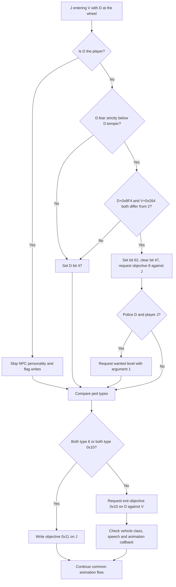
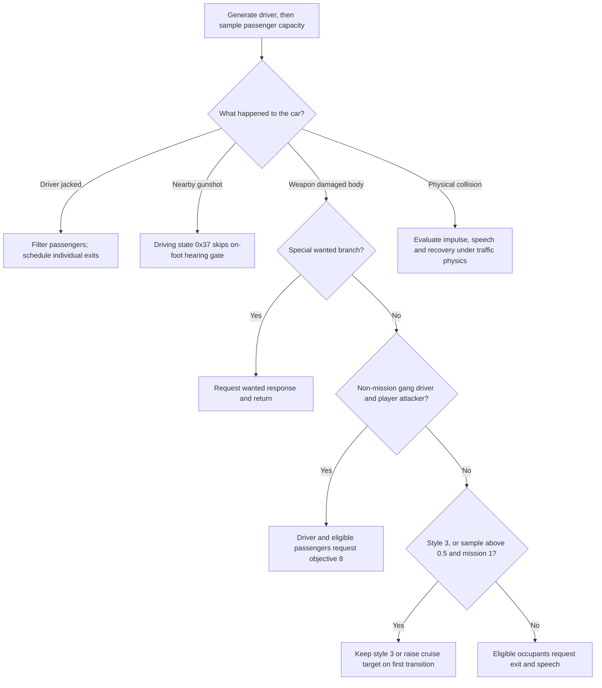
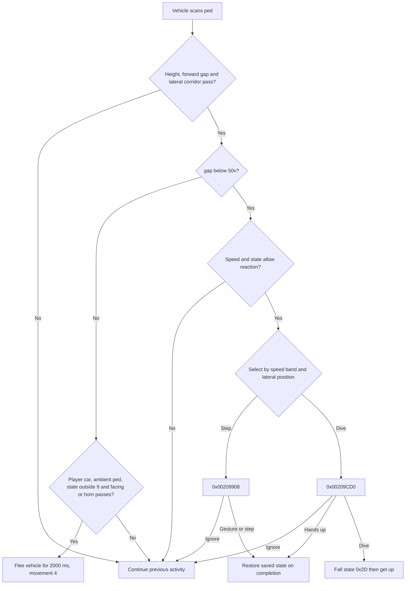

# Vehicle encounters

US PS2 `SLUS_215.90`. D is the original driver, J the jacker, V the vehicle and P a passenger. The current objective lives at ped+0x8A4 and body state at +0x8C4. Record both even when their numeric values coincide.

## Jacking an occupied car

`0x002FD838` takes an animation association and J. Read V from J+0x480 and D from V+0x384. This diagram begins after the ordinary driver-dispute branch's entry and door checks.

| Order | PS2 decision | Test |
|---|---|---|
| Callback eligibility | Return for missing vehicle, vehicle entity status 5, or J state 0x39, 0x3A or 0x37. States 0x3B/0x3D continue normal flow; remaining states call `0x003021C0`. Player cancellation, models and doors have separate branches. | Interrupt entry before completion and observe the same driver and seat. |
| Driver-dispute branch | D exists and J has objective 0x12 or state 0x3B. V+0x260 bit 49 takes a special vehicle path. D equal to J or J+0x8F2 equal to 10 bypasses this preset response. | Compare empty seat, occupied ordinary vehicle and special vehicle. |
| Personality | `0x002FDCB0` and `0x002FDCB4` use signed byte loads at offsets 0x16 and 0x17 in *(D+0x554). Failure or either creation-source exclusion goes to `0x002FDD68`. Bits 47 and 62 are in the 64-bit field D+0x1C8. | Fear/temper 29/30, 30/30 and 31/30: only the first reaches source tests. Repeat with D or V source 2. |
| Objective and exit | `0x002FDD1C` requests objective 8 on D against J. Ordinary differing types then request objective 0x10 against V after `0x002FDD80`. A regular car requests speech 0x7A on D. Completion continues through `0x002FDF80`. | Record D's current and saved objectives, vehicle and actor target before and after actual seat transfer. |

### Landing after an ordinary drag

`0x00306680` positions D using vehicle, side and animation root travel. V here is the reference read from D+0x484. The table requires a valid V, an NPC and a successful `0x001FDAE0(D)` check. Evaluate in order.

| D+0x1C8 flags and inputs | Effect |
|---|---|
| Bit 47 | Clear bit 47 and pass V's current XY **by position** to `0x00205A68` for 4000 ms. A moving car does not move this flee origin. |
| Bit 47 clear, bit 48 set | Choose one of eight wander directions via `0x00206568` and clear bit 48. |
| Neither above, bit 62 set | Clear bits 62 and 47. For gang types 7–15 with source other than 2 and 3D player distance strictly below 3.5, assign the player to D+0x8A0. If this slot holds a target and V has a driver, request objective 8 against **the current driver of V**, the a2 load at `0x00306BA0`. With an empty seat, finish this choice. |
| Bit 62 path with empty D+0x8A0 | If V has no driver, D still drives it, or the player drives it and `0x00255DA8` returns true, reset and flee V's XY for 4000 ms. Otherwise call `0x003BC778` and request objective 0x12 against V to reclaim it. |
| Bits 47, 48 and 62 all clear | Reclaim requires temper > fear, non-2 creation sources for D and V, a false `0x00255DA8`, and either the player driving or the empty car referenced by player+0x484. Otherwise reset state, flee V's position for 10000 ms, set bit 30 and call `0x00218750`. |

For a target-identity check, swap in a third driver after the ped target is stored and inspect a2 at `0x00306BAC`. Fast drag uses `0x00306010`: its bit-47 branch flees for 14000 ms, and its bit-62 path can retain the original attack target. [Fast drag and reclaim completion](vcs-carjack.md)

Ordinary non-drag exit also has `0x001FDE18`. With prior state 0x3F, non-player, valid V, bit 47 and outside the non-mission gang exception, flee the car's XY for 12000 ms. If the random low bit is zero and fear <71, use movement 4 and speech 0x8E; otherwise use movement 5 and speech 0x77. Test fear 70 and 71 with the same even sample.

## Executing objective 8

| Stage | Rule |
|---|---|
| Accept | `0x003BB670` rejects null/self targets, actor states 0x39/0x3A/0x20, bit 9 of the virtual-slot-0x70 result's +8 field, or a matching nonzero saved objective. Repeating 8 against the same ped returns early. A different target while now < ped+0x6D4 can also be rejected if the old target exists and `0x002FCE00` passes. |
| Preserve | `0x003BB4A0` recognizes temporary objectives 0x10, 0x11, 0x12, 0x1D and 0x26. Incoming 8 during a temporary objective is stored in +0x280. Requesting 8 updates target slots +0x8A0 and +0x6B4; requesting exit keeps a separate vehicle reference at +0x484. |
| Dispatch | `0x003BC9A8` reads current objective at `0x003BCC34`. Entry 8 in the table at `0x004BD620` targets `0x003BFAE8`. If the actor remains in its own car, request 0x10 against that car. Objective 9 has its own vehicle-pursuit path. |
| On foot | A missing target or target in 0x39/0x3A sets +0x1C8 bit 39, calls `0x001F0E48` and reaches common cleanup. For a live target, `0x002CEA70` tests weapon-info+4 == 0. True selects **melee 0x00101D30**; false selects **non-melee 0x00100BA0**. Both take actor, positions and displacement. Result 2 calls virtual slot 0x80 and returns immediately. Other results call the slot and reach common cleanup. [Combat decision tree](vcs-npc-combat.md) |
| Complete or defer | `0x003C0F78` checks bit 39 or a nonzero +0x6DC strictly before now. Otherwise continue. Special case: source 1, on foot, objective 8, state 0x11, valid ped through virtual slot 0x70 result+0xC, target outside 0x39/0x3A. Defer cleanup, calling `0x003BB3D8(ped,2000)` for nonzero deadline. Ordinary completion calls `0x003BC8F8` to restore +0x280 as current objective, clear the saved slot and bit 39. For current objective 8, clear ped target except in state 0x3B. |

**Walkthrough.** Type-mismatched eligible driver with fear 10/temper 30 first requests 8 against J. Seeing 0x10 against V next is expected. Once 8 resumes, remove the target or move it to 0x39 to exercise completion. With 30/30 expect bit 47 and exit instead. In a prior PCSX2 trace a driver entered body **state** 8 after exit and fled. [Original and MTA observations](vcs-street-ai.md)

## Passengers and threats to the vehicle

| Entry | Decision | Test |
|---|---|---|
| Population `0x00430290` | `0x00395868` calculates capacity from model type, doors and handling flags. `0x003E6998` writes V+0x235. Each capacity unit independently accepts random <0.125. Fill the resulting number of seats front to back. Some models skip first passenger position at `0x003E91B0`. | Samples 0.125 and 0.124 give one passenger, without reserving the second seat specifically. |
| Passenger exit `0x003EF018` | Exclude empty seat, displaced ped and normally P+0x1D0 bit 31. Non-player jacker's selected door can re-admit a candidate. A police jacker targeting a wanted player can return that pair early. Deadlines +0x6C0 begin at now+1800. For bit-31-clear candidates request 0x10 and advance cumulative delay by 300–599. | Two eligible passengers get 1800 and 2100–2399. Regular cars may perform a binary draw, then extend extra candidates to 10000 and set bit 47 if type 5/0x14 or a subsequent draw passes. Extra candidate means seat index >0 or displaced ped was driver. |
| Weapon damage `0x003EF910` | Require V+0x264 == 1, V+0x354 != 1, entity status 2/3. V+0x260 bit 40 or model 0x105/0xDB/0xCF/0xEA with player attacker triggers wanted and returns. A driver type 7–15, source other than 2, with player attacker requests 8. Occupied passengers whose current objective differs from 8 and source differs from 2 also request 8; deadlines +0x6DC advance by 200 ms per eligible passenger. | Skip an occupant already on objective 8. The first remaining eligible passenger still gets now+200. Deadline and animation onset are separate observations. |
| Ordinary damage reaction | Style 3 skips sampling. Otherwise sample once. If >0.5 with V+0x215 == 1, a present driver outside objective 0x10 sets style 3 and on first transition multiplies cruise target V+0x217 by 1.5 with integer truncation. Other path sets bit 47, requests 0x10 and speech 0x77 for eligible occupants. Driver requires source other than 2 and vehicle class other than 4; passengers are filtered separately. | With normal style and mission 1, 0.499 and 0.500 select the exit branch; 0.501 selects acceleration. Test nearby shots, direct hits and collision separately. [Damage speech](vcs-voice-calls.md) · [Vehicle impact](vcs-vehicle-impact.md) |

## A vehicle approaches a pedestrian

Equality at gap=50v takes the farther branch. In the urgent branch, v>0.3 selects step only for lateral offset >W+0.1; with 0.1<v≤0.3 and state outside 0x11, lateral offset ≤W−0.5 selects dive. States 0x1F and 0x30 gate repeated evasion. Stats flag +0x14 & 0x10 can change the ordinary dive to hands up. Ordinary and horn-forced modes differ in speech. [Geometry, probabilities, animation and replay evidence](vcs-vehicle-evade.md)

## Implementation boundary

`traffic_road.lua` distinguishes seat-entry attempt, exit and completed entry. `ped_carjack.lua` handles the same D after exit. The 3.5 distance exists in the PS2 callback; compare the port's grouping of that condition, police type and stored attack target. Syncer retries and fallback on a destroyed car are MTA adaptations. `ped_evasion.lua`, `ped_evasion_c.lua` and `ped_evasion_s.lua` implement vehicle approach, landing and recovery. A diving ped can still be hit. For SA structure see `gta-reversed@04c5b664`, `TaskComplexCarSlowBeDraggedOutAndStandUp.cpp`; its next-task and abort methods forward to the executable. The PS2 rules above use VCS instructions and callbacks.
