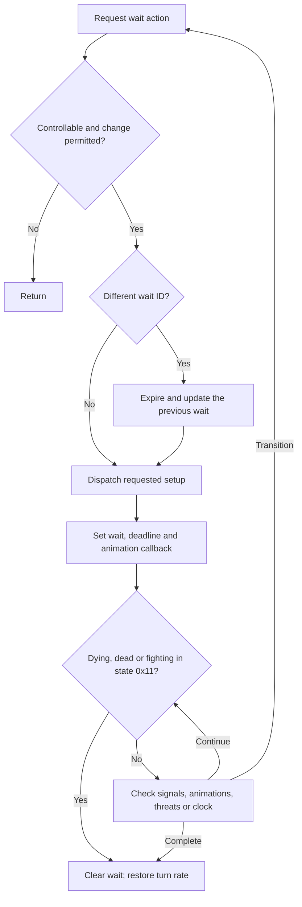

# NPC wait actions

US PS2 VCS stores the current wait ID at ped+0x8CC and its absolute deadline in milliseconds at +0x8D0. These fields coexist with ped state (+0x8C4) and objective (+0x8A4). A wandering ped can wait for a light, and an intimidated ped can wait for the gun to lower.

`0x0020ED50(P,id,durationPtr,flag,force)` first checks `0x001FD9E0`. Bit 40 of P+0xE8 converts the request to 0. State 0x11 rejects it unless force is set. On an ID change, `0x002106E0(0,P)` zeros the previous deadline, restores turn rate and runs the previous wait's update. An animation callback can do the same. Repeating an ID can run its setup again unless the producer guards against repetition. `0x0020F638` clears waits for state 0x39, 0x3A or 0x11. Most timed branches advance on **now > deadline**.

Setup table `0x004ABD70` and update table `0x004ABE00` both take index ID−1 for IDs 1 through 0x21. Zero and out-of-range setup use cleanup at `0x0020F5D0`, while the default update goes to `0x002105FC`. IDs, addresses and animation IDs below are hexadecimal. Durations are decimal milliseconds.

| ID | Setup address | Update address | Rule and transition |
|---|---|---|---|
| 01 | 0020EDFC | 0020F6B8 | Crossing signal. Stop for 500; after expiry poll phase and resume movement 2 when allowed. |
| 02 | 0020EE20 | 0020F6E8 | Crossing segment. Animation 0B for 1000. At expiry, clear if random low bit is one or deadline is zero, else enter 03. |
| 03 | 0020EE48 | 0020F774 | Look around with animation 95 for supplied duration or random 2000–4999. Clear and fade out on expiry. |
| 04–07 | 0020F5E8 | 002105FC | Each stores its own ID and uses shared update exit. |
| 08 | 0020EE9C | 0020F7C0 | Failed path continuation. Animation 0B, 3500. When 2001–2499 remain, subtract 500 and play 94. On expiry clear and set movement 2. |
| 09 | 0020EEC8 | 0020F834 | Animation 29, 5000 and finish callback. Randomly created passenger entering a car under objective 11/state 18 can clear objective, restore previous state and set +0x6D8 to now+30000. |
| 0A | 0020EF6C | 0020F854 | Animation 96, 5000. On expiry turn by π; state 1E also runs investigation cleanup. |
| 0B | 0020EF98 | 0020F8BC | Animation 29, 2000. If still present at expiry, start 94 and wait another 5000; otherwise clear. |
| 0C | 0020EFE8 | 0020F974 | Stop, start 0C for 5000. At expiry check current animation; random low two bits can select 95, 0C, 94 or 96 and another 1500–4999. Animation 96 has a turn-and-resume exit. |
| 0D | 0020F090 | 0020F928 | Stop, animation 0B for 5000. Clear and fade on expiry. |
| 0E | 0020F144 | 0020FEB8 | Animation 99 for supplied duration or 3000, then fade and clear. |
| 0F | 0020F0DC | 0020FEB4 | Animation 9D for supplied duration or 3000, then animation-specific cleanup. |
| 10 | 0020F148 | 0020FEC4 | Animation 0F for supplied duration or 3000. While waiting, objectives 0C and 08 can refresh attention and orientation toward a valid target. |
| 11 | 0020F0E0 | 0020FB70 | Gun threat, animation 9C, supplied duration or 3000. Target, deadline, current state and personality govern exit. |
| 12 | 0020F0EC | 0020FB74 | Shares the threat update with 11, animation 9D. |
| 13 | 0020F154 | 0020FED0 | Animation 0E, supplied duration or 3000. With attractor and objective 36, notify attractor and set flag at completion. |
| 14 | 0020F1DC | 0020FFD4 | Stop, animation 0C for 2500. At expiry, if association exists, blend animation 6 and enter 03 with duration 2000. |
| 15 | 0020F234 | 00210048 | Sit down, animation A2 with 100000 deadline. Animation completion can expire it earlier; transition to 18. |
| 16 | 0020F5D0 | 002105FC | Default setup cleanup. Cleanup recognizes an already stored ID 16. |
| 17 | 0020F250 | 0021019C | Stand from seat, animation A3, 100000 and callback. Notify attractor; if P+0x1D0 bit 19 and P+0x55C is valid, flee that entity for 10000 and request speech 77. |
| 18 | 0020F2A4 | 00210074 | Seated loop A4 for supplied time or 25000+5000×random float. Timeout or qualifying threat advances to 17. Threat interruption records a source before standing. |
| 19 | 0020F304 | 00210238 | Animation A6, supplied time or 100000. Notify valid attractor and clear on completion. |
| 1A, 1B | 0020F5D0 | 002105FC | Both use default setup cleanup. |
| 1C | 0020F370 | 0021027C | Beach group 19 animation DB, 50000+50000×random float. Test weather, hour, threat, and player's vehicle trajectory before getting up. |
| 1D | 0020F40C | 002105FC | Call 002022F0(P,-1,0x1C,1). Shared update. If animation 1C exists at cleanup, call 00203240. |
| 1E | 0020F428 | 002105B4 | Animation 37 for duration read through the supplied pointer. At expiry clear and fade. |
| 1F | 0020F5E8 | 00210598 | Store ID. Update calls 0020E930(P,0x1C,0xE4,7); cleanup uses animation table 004ABD28. |
| 20 | 0020F460 | 002105FC | Weapon flags 0x2000/0x80000 select D7/DA. New association gets 5000 and a callback. Shared update. |
| 21 | 0020F570 | 002105DC | Animation 9C for supplied duration. Register callback; clear and fade at expiry. |

## Decision tests

- **Crossing.** In wander update `0x00206878`, valid path followed by `0x00218DB0` selects 01; failing that, `0x00218D48` selects 02. At `0x00313450`, compute k=(now & 0x7FFF)>>1. Return 2 for k < 12000, 0 for 12000–15383, 1 thereafter. Only 0 releases wait 01 after the initial deadline. Check equality at deadline and k=11999, 12000, 15383, 15384.
- **Blocked path.** The separate `0x00218E48(P,0)` branch selects 08 and requests speech 97. Collision/update sites including `0x001F56A8` can request 0C instead. Compare pedestrian light, missing next path node and obstruction; record +0x8CC, next movement and heading.
- **Bench.** Trace 15 → 18 → 17. Interrupt the seated loop with a threat, observe standing and subsequent flee target. The 100000 values in setup are deadlines; finished animation can advance the sequence earlier. [Activities and attractors](vcs-npc-activities.md)
- **Release.** `0x0020EB78` cleans according to old ID, fading specific animations and notifying an attractor when applicable, then clears +0x8CC. `0x00210720` restores +0x8E8 from stats+8, multiplied by five for NPCs. Compare a seated ped transitioning into state 11 with a seated wait expiring normally. Check seat ownership and wait ID independently.
- **Evidence.** Both dispatch tables were read from the US ELF. A shared exit such as 04–07 only describes this dispatch point. Entry conditions and animation ownership may reside elsewhere. [Gun threat and hands-up waits](vcs-npc-special.md)

## Ambient production entry

For the US packed links, inspect 0x00218DB0 to 0x0026AF18 (bit 14) and 0x00218D48 to 0x0026B180 (bit 15). The PS2 ambient walker requests wait 01 for a traffic signal or wait 02 for an unsignalized crossing. The server observes the 500 ms initial deadline and accepts only pedestrian-clock phase 12000 through 15383 inclusive. Wait 02 plays the original IDLE_HBHB for 1000 ms, then either continues or enters 03/ROADCROSS. A failed continuation enters 08, with XPRESSscratch and the 500 ms deadline reduction in its original remaining-time window. Inspect `ped_ambient_wait.lua`, `traffic_ambient.lua` and the boundaries in `tools/ped_ambient_check.py`. The server retains the pending edge through the wait and discards it when damage or scripted control interrupts.
