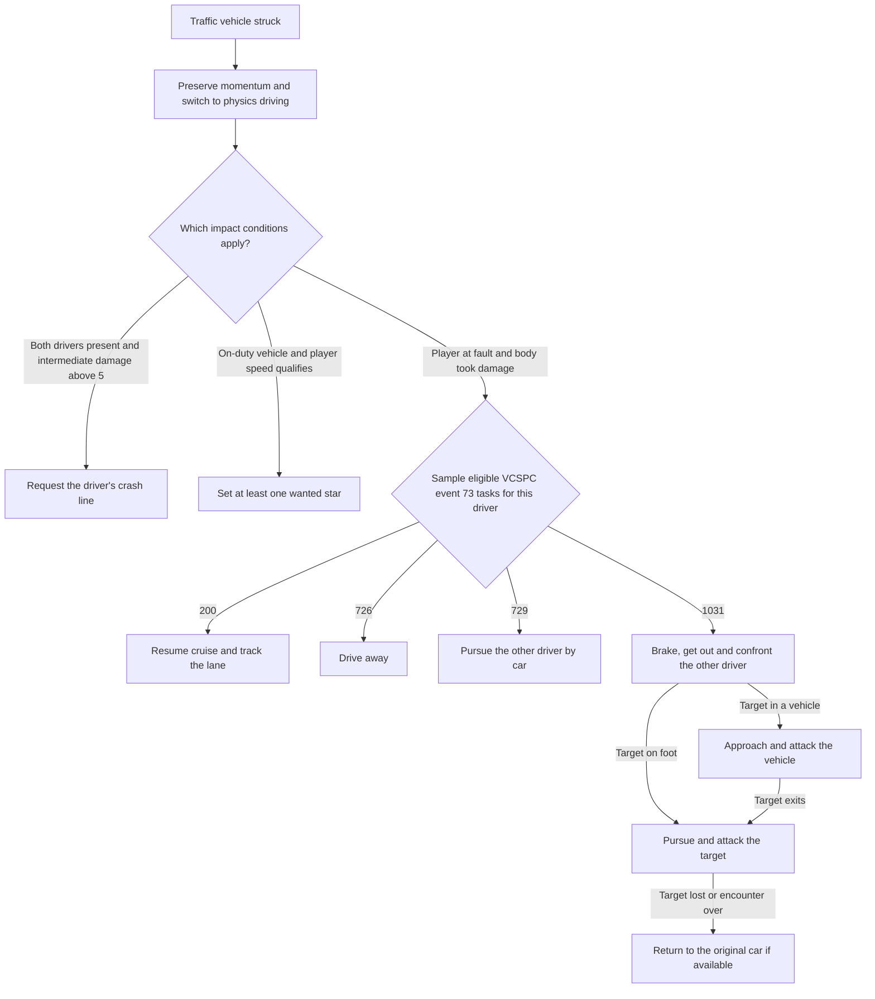

# When a player drives into a traffic vehicle

The target in Ghidra is the US PS2 `SLUS_215.90 (VCS)`. The ELF SHA-256 is `3b43be57d60a29df35e41504d67bbf728d5ce2fc5aab6bbf928cbbc5963fe547`. Trace the body, driver and driving task separately.

| Stage | PS2 observation |
| --- | --- |
| Switch to full physics | 00353640–00353688 changes simple traffic status 2 to physics status 3. The vehicle path calls 0043B558, sets driving task to cruise (1), clears the temporary action and refreshes timers at +1F8 and +1FC. Linear and angular velocity, heading, cruise speed and driving style are preserved. |
| Collision damage | 00136C10 reads this frame's physical impulse from +10C and the other entity from +150. Ordinary cars process an impulse strictly above 25. At 0013771C intermediate damage equals (impulse − 25) × handling collision-damage factor × 0.6. Special vehicles and other entry points have additional multipliers. |
| Driver speech | Intermediate damage must exceed 5 and both vehicles must have drivers to request voice event 8Fh from the struck car's driver. A player vehicle hitting a mission car has an exception. Source and protection multipliers affect health loss later. MTA uses the model's disc coefficient and the actor's voice bank. There are 269 distinct samples across 122 models for this event. Model 23 uses 1859 or 1860. |
| Police vehicles | At 00136F94–00136FA4 the vehicle must be on duty, in serviceable status, and struck by the player's car. Compare 3D speeds. Player speed strictly above 0.1 and at least equal to the struck car's speed triggers 002379E0(player,1). 003AAC80 ensures at least one wanted star. 003EA0E0 maintains the on-duty flag and vehicle count. Random traffic classes 13, 23 and 24 receive it at 00431D34–00431DB0. |
| Blocked vehicle | 0042A228–0042A35C handles freeing a physics vehicle. Random traffic on an ordinary cruise skips one branch at 0042A284. Other eligible tasks and styles can reverse for 700 or 1500 ms after over 2000 ms nearly stationary, subject to speed and recent contact. A separate branch at 0042A364–0042A3F8 handles a cruising vehicle whose three low random bits are zero and which is clear of a bridge wait. Crossing roughly 30 seconds stationary switches to avoidance style 2 and reverses for 400 ms. |
| Severe damage | At 001379B4, health below 250 can raise engine damage to 225. The preceding call at 001379AC takes the audio handle, wheel and sound event 13h. Gunshot-triggered abandonment or acceleration has its own entry at 003EF910. The ordinary physical car collision path has no observed direct call to it. |

## Handling data and comparison sources

Near the CAutomobile constructor at 00133840, the vehicle model's +38h handling pointer is copied to vehicle +160h. In decompressed PS2/GAME.DTZ, read the model count and pointer table from header offset 38h. Index by model, select records with class byte 6 at +10h and read the little-endian float at handling +C8h. Model 171 gives 0.703448236. Regenerate the traffic resource's coefficients for 111 models with `py -B tools/vehicle_impact_import.py <disc-directory>`.

In gta-reversed, `source/game_sa/Entity/Physical.cpp` contains the full-physics transition in CPhysical::ProcessCollision. Automobile::VehicleDamage, EventVehicleDamage and EventHandler::ComputeVehicleDamageResponse show the SA separation between impact, attribution and driver tasks. SA can start a road-rage task. The VCS PS2 evidence above directly establishes speech, physics transition and conditional recovery from obstruction. VCSPC's Vehicle.h helps identify flag terminology in a project that retains parts of the SA engine.

## Road rage in the PC conversion

VCSPC's `data/decision/PedEvent.txt` identifies collision damage as event 73. The corresponding rows in R_Norm.ped, R_Tough.ped and R_Weak.ped give weights by relationship. gta-reversed's DecisionMakerTypesFileLoader.cpp orders the columns as friend, threat, player and neutral. In VCSPC's gta-vcs.exe, 00600590–006005C1 stores weights as bytes, 00604139–00604168 filters eligible tasks, and 006041A8–006041D7 normalizes by their sum.

| Driver facing a player at fault | Continue (200) | Drive away (726) | Road rage (1031) | Attack by car (729) |
| --- | ---: | ---: | ---: | ---: |
| Normal | 50 | 25 | 25 | 25 |
| Tough | 50 | 0 | 50 | 150 |
| Weak | 50 | 50 | 0 | 0 |

SA's TaskComplexRoadRage.cpp traces exiting, facing the other driver, gesturing, approaching, attacking and returning to the original car. Evidence for these weights in this project comes from VCSPC. Equivalent decision files or weights have yet to be established on PS2.

## Original-game observations

In PCSX2 the fixture set the initial positions and speeds, then the player's vehicle physically hit an NPC car controlled by the original game. In the rear-end test with driver model 48 the car changed from status 2 to 3 within about 46 ms. Health fell from 1000 to 909.6, then to 876.9 during further contact. The driver stayed in state 55 with cruise speed 10, style 0, task 1 and temporary action 0. Speed approached zero at 0.69 s, recovered to 0.163 at 2.77 s and the car was still moving at 5.07 s.

In the side-impact test with driver model 27, vehicle +150 pointed to the player's vehicle and +10C read 422.15 at 47 ms. Health was 883.5 at 0.14 s. The car shifted about 8.7 world units sideways and returned near its original lane by 2.77 s. Style, task, temporary action and cruise speed stayed 0, 1, 0 and 11. Each test tracked the same vehicle and driver before and after impact.

## Collision decisions in the MTA port

Rebuild coefficients, access flags and the player-impact table with `py -B tools/vehicle_impact_import.py "<disc-directory>" --vcs-pc-dir "D:/Game/vcs_pc_edition"`. The integration points are traffic_world_c.lua, traffic_vehicle_collision.lua and traffic_road.lua. Clients report forces on their respective vehicle bodies. The server merges duplicate or out-of-order contact and damage reports. [MTA collision event parameters](https://wiki.multitheftauto.com/wiki/OnClientVehicleCollision)

In native MTA 1.7 server testing, original model 170 (coefficient about 0.51) requested no speech at impulse 41 and requested one line at 42. A duplicate after 50 ms merged with the original report. An independent impact after 1.4 s could request another line. A separate test supplied player attribution and body damage, then sampled 1031 for a tough driver. The server accepted the brake task. Following simulated exit confirmation it issued the confrontation, occupied-vehicle attack, and pursuit of the dismounted target in order.

## Motorcycles and riders

The PS2 bike damage routine starts at 00336448. Use the assembly listing at 00336590–00336670 where Ghidra lacks a decompiled body. For ordinary impulses above 25 subtract 25 and multiply by the original handling coefficient at +C8h. Bikes omit the car's 0.6 multiplier. Intermediate damage above 5 with both drivers present requests speech 8Fh at 0033666C, subject to the player-versus-mission-vehicle exception. The on-duty police bike check at 00336678–00336798 is inside this damage-above-5 branch and then tests vehicle identity and speeds.

Knocking off a rider uses a separate calculation. At 0033647C–003364E4, scale impulse by 800 divided by bike mass. Player-controlled vehicles have a 0.65 factor and mission-created vehicles a 0.4 factor. At 003368F0–00336928 require driver state 55 and an initial value strictly above 10. At 00336934–00336B14, weight the impact's projections on the vehicle's forward, right and up axes by model. A result strictly above 75 requests damage to a living rider equal to result × 0.05 with the actual collision entity as source. If still driving, 00336B90 calls 003F0A58 to detach the rider. 00336C70 checks the first passenger. A minor impact can draw a shout while the rider keeps going. A heavier one can unseat them.

## Vehicle pursuit and dismount

In the PS2 Ghidra program `SLUS_215.90 (VCS)`, open `00428C48` and follow the mission dispatch to `00429110` (RAMPLAYER_CLOSE) and `00429488` (BLOCKPLAYER_CLOSE). The enforcement branches check the player's situation and distance before ordering occupants out. The ram branch includes speed 0.05 and the distance gate is 14 game units. Follow the call to `0042AD80` to see driver and passenger objective 0x10. Near `00429B74` the close/far mission switch rejoins the road system. The contact branch around `00429B90` can request a short reverse when nearly stopped against its target. These locations establish the enforcement behavior. The civilian task 729 selection comes from the PC Edition decision files described above.

The MTA civilian pursuit uses its own progress and exit rules in `traffic_vehicle_pursuit.lua`. Two missed passes or four seconds without gaining a metre allow a dismount check within ten metres, after the target has stayed within one metre for two seconds. The client probes floor, steps, water, overhead clearance and the walking corridor from the driver's door to the player or the outside of the player's car. A positive response starts braking. At speed 0.05 or lower the syncer checks again before requesting the native vehicle exit. A moving target cancels braking. An impassable approach allows one attempt to rejoin the directed road graph, bounded to eight seconds. The traffic manager transfers the same NPC into its on-foot task after seat release. A script taking ownership cancels this pursuit and can release control back to road driving.

Run `py -B tools/check_vcs_traffic.py` for pass counting, timeout and reroute limits, canceling an exit against a moving target, and the on-foot and occupied-car probes. Those tests use simulated geometry and seat events.
### Checking pedestrian injuries and motorcycle exits

In Ghidra open the US executable `SLUS_215.90 (VCS)`. At `001ED840` the pedestrian constructor writes 100 health at +4E4h, zero armour at +4E8h, mass 70 at +D0h and turn mass 100 at +D4h. The non-player branch in `001D7940` multiplies incoming damage by the personality float at +10h. Regenerate all 42 values with `py -B tools/ped_ai_profiles.py "<disc>"`. Ambient VCS spawns express this as an equivalent MTA health budget of 100 divided by the multiplier. For example STAT_OLD_GUY has a budget of 40 and STAT_STREET_GUY has 100. MTA still resolves weapon and body-part damage.

Follow the vehicle contact call into `001DA320`. For an ordinary civilian, impulse above 6 applies 30 base damage and requests a one-second knockdown. The downward contact branch below −0.8 opens at impulse above 3. Above 12 the severe branch uses 1000 base damage. Inspect the right, forward and up projections and the bounding-box extents for flank, run-over and bonnet trajectories. `003562C0` writes the movement vector; `00347D20` adds force. MTA exposes the other body's force only for vehicle targets. For a pedestrian contact the client estimates normal impulse from the closing component of relative velocity and the reduced mass of the two bodies (70 for the pedestrian, handling mass for the vehicle). This estimate adapts the engine event to the PS2 thresholds. The server checks synchronized vehicle motion and deduplicates reports from the ped syncer and the driver. VCSPC’s `VCS PC/General.h` distinguishes physical mass, turn mass and the stored damage impulse. The VCS response coefficients come from the PS2 executable. The client keeps short pre-contact motion samples for callbacks delivered after the solver has already slowed the car. A frontal pedestrian contact may restore excess forward speed loss on the locally driven automobile using the impulse and vehicle mass. Braking suppresses the adjustment. This is a port approximation. The server also tests recent vehicle travel when the network report arrives after the car has passed the victim. [MTA collision event](https://wiki.multitheftauto.com/wiki/OnClientVehicleCollision) Network motion checks, duplicate suppression and native-damage reconciliation are port decisions.

For a bike inspect `0033647C`, `00336934` and `00336B08`. The export reads the original mass at handling +BCh. After the weighted value exceeds 75, follow the detach call at `00336B90` to `003F0A58`. Reason 2Ah selects the pointer at `004C2A48`, which leads to `003F0EF8`. The rider inherits the bike velocity. The horizontal velocity change is −0.6 times contact impulse divided by bike mass, along the horizontal contact normal. The random upward force is 8–15 against a 70-unit ped. On recovery the driver can regain the bike, the passenger can reboard, and an identified aggressor can enter the existing pedestrian reaction tree. The 1.2-second seat-event correlation window handles MTA reporting an exit before the thief or the impact.

Run `py -B tools/check_vcs_traffic.py --disc "<disc>" --native` and `py -B tools/ped_evasion_check.py`. Checks cover a late thief, repeated impact reports, the strict injury boundaries, light and heavy contact, landing before recovery, native SA dodge clips and syncer changes. For client observation, approach a facing pedestrian head-on, repeat off-centre, then block the preferred landing side. The original awareness and personality gates allow different reactions.

For high-speed frontal hits, inspect `checkBumperTravel` in `traffic_world_c.lua`. It tests a crossing of the driven automobile's bumper between two motion samples, including lateral and vertical bounds and static line of sight. When a native contact occurs near the bumper with an upward bonnet normal, longitudinal closing speed can still drive the PS2 injury thresholds. The server validates the reported contact against the ped and the car's motion, allowing up to 120 ms of forward sync lag. Regression cases in `tools/check_vcs_traffic.py` include a missed callback, bonnet contact, a pass beside the pedestrian, an elevated pedestrian, occlusion and a real native MTA pedestrian receiving lethal damage.
